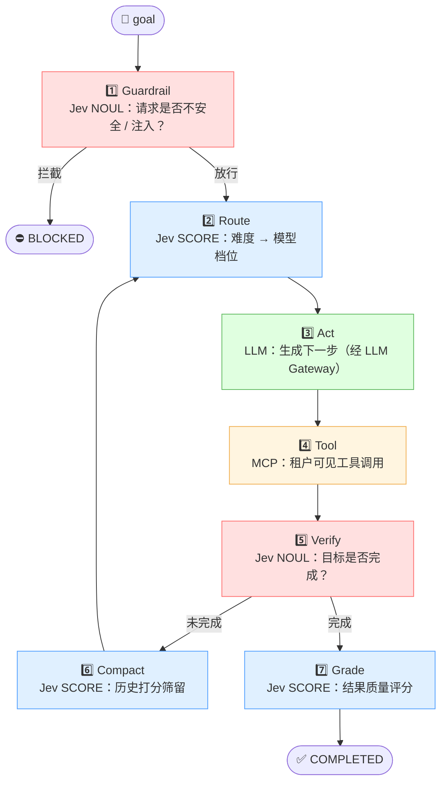
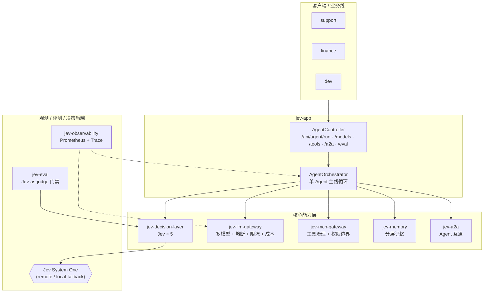

<div align="center">

# 🧠 Jev Agent Runtime

**企业级智能体运行时 / 智能体网关**

*Jev-driven Enterprise Agent Runtime & Intelligent Agent Gateway*

[](https://openjdk.org/projects/jdk/21/)
[](https://spring.io/projects/spring-boot)
[](https://spring.io/projects/spring-ai)
[](https://modelcontextprotocol.io/)
[](https://a2aproject.github.io/A2A/)
[](https://aiwiki.ai/wiki/jev)
[](#-许可证)

以 **Jev "System One" 决策模型** 为决策/校验层、**单 Agent 为主线**、**弹性多 Agent 为补充**，
把「模型路由、工具治理、多租户隔离、可观测、评测」收拢为一个统一控制面的企业级 Agent 基础设施。

<sub>面向 2026 秋招「Java 后端 + AI Agent」方向 · JVM / 高并发 / IO / Spring 全家桶全覆盖</sub>

</div>

---

## 📖 目录

- [项目简介](#-项目简介)
- [为什么是 Jev：快慢分工](#-为什么是-jev快慢分工)
- [Jev 贯穿全链路（五大用途）](#-jev-贯穿全链路五大用途)
- [系统架构](#-系统架构)
- [模块划分](#-模块划分)
- [技术栈](#-技术栈)
- [快速开始](#-快速开始)
- [REST API](#-rest-api)
- [可观测与指标](#-可观测与指标)
- [配置说明](#-配置说明)
- [项目结构](#-项目结构)
- [文档索引](#-文档索引)
- [生产化路线](#-生产化路线)
- [简历亮点（量化指标）](#-简历亮点量化指标)
- [常见问题](#-常见问题)
- [免责声明](#-免责声明)

---

## 🚀 项目简介

多业务线（客服、数据分析、研发助手）把各自的 Agent 接入本运行时，由它**统一**负责：

| 能力域 | 说明 |
|---|---|
| 🎯 **模型路由与成本治理** | Jev 判难度 → 选模型档位 → 多供应商容错 → 多租户预算熔断 |
| 🔧 **MCP 工具治理** | 工具注册 / 发现，租户级权限边界，调用审计 |
| 🏢 **多租户隔离** | 限流、预算、工具可见性、记忆分区全链路以 `tenantId` 为键 |
| 📊 **可观测** | Prometheus 指标 + 单次运行的决策轨迹（trace） |
| 🧪 **评测** | 黄金数据集 + Jev-as-judge 回归门禁（eval as a release gate） |

> **设计哲学**：贵的大模型只做「慢思考生成」，高频的「快判断」全部下沉到 Jev。
> 单一 Agent 把链路做深做透，多 Agent 只作为「弹性补充」——避免盲目堆叠带来的 token 爆炸。

---

## ⚡ 为什么是 Jev：快慢分工

Jev 是 TypeSafe AI 于 2026-09 发布的 **"System One" 决策模型**，它**不生成文本**，
只返回三种类型化原语，且可在**同一次前向**中并行计算：

| 原语 | 语义 | 返回值 | 本项目用途 |
|---|---|---|---|
| `CHOICE` | 从封闭候选集中选择 | 选项 + 索引 | 下一步动作 / 工具选择 |
| `SCORE` | 连续评分 | `[0,1]` | 难度评估、上下文相关性、结果质量 |
| `NOUL` | 校准后的布尔概率 | `[0,1]` | 护栏（注入/不安全）、轨迹是否完成 |

**为什么要它？** 官方数据称 Jev 端到端 **70–500ms**，较主流 LLM 快约 **193.6×**、成本低至约 **1/444.6**，输出免费。
把高频判断下沉，可以在保持质量的前提下大幅降低成本与延迟。

> ⚠️ **落地提醒**：Jev 官方 API 尚未对中国大陆开放。本项目内置**确定性离线校准兜底实现**（`LocalJevClient`），
> **默认即可端到端运行，无需任何外部凭据**；配置 `jev.fallback-local=false` 并填入 `jev.api-key` 即切换到远程 Jev。

---

## 🔗 Jev 贯穿全链路（五大用途）



| # | 步骤 | 原语 | 组件 |
|---|---|---|---|
| 1 | 请求侧护栏 | `NOUL` | `JevGuardrail` |
| 2 | 难度→模型路由 | `SCORE` | `JevRouter` |
| 3 | 生成下一步 | — | `LlmGateway` |
| 4 | 工具调用 | — | `McpGateway` |
| 5 | 轨迹校验 | `NOUL` | `JevTrajectoryVerifier` |
| 6 | 上下文压缩 | `SCORE` | `JevContextCompactor` |
| 7 | 结果评分 | `SCORE` | `JevGrader` |

---

## 🏛 系统架构



更多架构细节见 [`docs/ARCHITECTURE.md`](docs/ARCHITECTURE.md)。

---

## 📦 模块划分

| 模块 | 职责 | 关键类 |
|---|---|---|
| `jev-runtime-common` | Jev 原语 / 请求 / 决策、远程与本地客户端、共享 DTO、自动配置 | `JevPrimitive` `JevClient` `LocalJevClient` `RemoteJevClient` |
| `jev-decision-layer` | Jev 五大用途：路由、护栏、轨迹校验、上下文压缩、结果评分 | `JevRouter` `JevGuardrail` `JevTrajectoryVerifier` `JevContextCompactor` `JevGrader` |
| `jev-llm-gateway` | 多模型路由、多供应商容错、熔断、租户限流、成本计量、Key 池 | `LlmGateway` `EndpointSelector` `CostMeter` `TenantRateLimiter` `KeyPool` |
| `jev-mcp-gateway` | MCP 工具注册 / 发现、租户级权限边界、调用 | `McpGateway` `InMemoryMcpRegistry` `McpExecutor` |
| `jev-a2a` | Agent Card 注册发现、跨 Agent 委派（弹性多 Agent 缝） | `A2aDirectory` `AgentCard` |
| `jev-memory` | 分层记忆 working / episodic / semantic | `LayeredMemoryService` `InMemoryMemoryStore` |
| `jev-observability` | Micrometer / Prometheus 指标 + 决策轨迹 | `AgentMetrics` `TraceRecorder` |
| `jev-eval` | 黄金数据集 + Jev-as-judge 回归门禁 | `EvalRunner` `EvalDataset` `EvalReport` |
| `jev-app` | Spring Boot 启动、编排器、REST 控制器、种子配置 | `JevAgentRuntimeApplication` `AgentOrchestrator` `AgentController` |

---

## 🛠 技术栈

| 层 | 选型 | 说明 |
|---|---|---|
| 语言 / 运行时 | **Java 21** | 虚拟线程、记录类、模式匹配 |
| 应用框架 | **Spring Boot 3.4** | 自动配置、Actuator、配置绑定 |
| Agent 编排 | **Spring AI 1.0** + 自研编排器 | ReAct 变体单 Agent 循环 |
| 决策模型 | **Jev System One** | 远程 + 离线校准兜底 |
| 工具协议 | **MCP** | 工具注册 / 发现 / 权限边界 |
| Agent 互通 | **A2A** | Agent Card + 委派 |
| 容错 | **Resilience4j** | 每端点熔断器 |
| 可观测 | **Micrometer + Prometheus + Actuator** | 指标 + 轨迹 |
| 构建 | **Maven 多模块** | 9 模块 |
| 文档 | **SpringDoc OpenAPI** | Swagger UI |

完整技术选型说明见 [`docs/TECH_STACK.md`](docs/TECH_STACK.md)。

---

## 🏁 快速开始

### 环境要求

- JDK 21+
- Maven 3.9+

### 构建与运行

```bash
# 构建全部模块
mvn -q clean package -DskipTests

# 运行（默认离线 Jev 兜底，无需任何外部凭据）
mvn -pl jev-app -am spring-boot:run

# 或者直接运行打包好的 jar
java -jar jev-app/target/jev-app-1.0.0.jar
```

启动后访问：

| 入口 | 地址 |
|---|---|
| 🟢 应用 | http://localhost:8080 |
| 📘 Swagger UI | http://localhost:8080/swagger-ui.html |
| 📈 Prometheus 指标 | http://localhost:8080/actuator/prometheus |
| ❤️ 健康检查 | http://localhost:8080/actuator/health |

---

## 🔌 REST API

### 运行一个 Agent 任务

```bash
curl -X POST http://localhost:8080/api/agent/run \
  -H 'Content-Type: application/json' \
  -d '{
    "tenantId": "support",
    "sessionId": "s1",
    "goal": "refund order 123 because it arrived damaged"
  }'
```

响应示例（含完整决策轨迹）：

```json
{
  "sessionId": "s1",
  "status": "COMPLETED",
  "answer": "[deepseek/deepseek-chat] simulated answer for: ...",
  "modelTier": "LARGE",
  "steps": [
    { "index": 0, "kind": "guardrail", "jevPrimitive": "NOUL", "jevValue": 0.05 },
    { "index": 1, "kind": "route",     "jevPrimitive": "SCORE", "jevValue": 0.72 },
    { "index": 2, "kind": "act",       "summary": "model=deepseek-chat" },
    { "index": 3, "kind": "verify",    "jevPrimitive": "NOUL", "jevValue": 0.9 }
  ],
  "metrics": { "steps": 3, "gradingScore": 0.53 }
}
```

### 其他端点

```bash
# 列出模型舰队
curl http://localhost:8080/api/models

# 查看某租户可见的工具（租户隔离）
curl 'http://localhost:8080/api/tools?tenantId=finance'

# 注册 / 查看 A2A 伙伴 Agent
curl -X POST http://localhost:8080/api/a2a/agents \
  -H 'Content-Type: application/json' \
  -d '{"name":"data-agent","description":"analytics","endpoint":"http://data:8083/a2a","version":"1.0","skills":["sql.run"],"streaming":true}'
curl http://localhost:8080/api/a2a/agents

# 运行评测门禁
curl -X POST http://localhost:8080/api/eval/run
```

完整接口文档见 [`docs/API.md`](docs/API.md)。

---

## 📈 可观测与指标

运行时通过 Micrometer 暴露以下核心指标（`/actuator/prometheus`）：

| 指标 | 类型 | 标签 | 含义 |
|---|---|---|---|
| `jev_decision_total` | Counter | `primitive`,`source` | Jev 决策次数 |
| `jev_decision_latency` | Timer | `primitive`,`source` | Jev 决策延迟 |
| `llm_request_total` | Counter | `tenant`,`provider`,`model`,`tier`,`status` | 模型调用次数（含 `circuit_open`） |
| `llm_request_latency` | Timer | `provider`,`model` | 模型调用延迟 |
| `llm_cost_usd_total` | Counter | `tenant`,`provider`,`model` | 累计成本（USD） |
| `llm_tokens_total` | Counter | `tenant`,`direction` | 输入/输出 token |
| `guardrail_block_total` | Counter | `tenant`,`reason` | 护栏拦截次数 |
| `context_compaction_saved_tokens` | Counter | — | 上下文压缩节省 token |

---

## ⚙️ 配置说明

`jev-app/src/main/resources/application.yml` 关键配置：

```yaml
server:
  port: 8080

spring:
  threads:
    virtual:
      enabled: true          # Java 21 虚拟线程

jev:
  base-url: https://api.typesafe.ai/v1
  api-key: ""                # 留空则使用离线兜底
  model: jev-latest          # System One 决策模型
  fallback-local: true       # true=离线校准兜底；false=远程 Jev
  fail-open: true            # true=远程失败回退本地兜底；false=抛 JevException（fail closed）
  timeout-ms: 2000
  max-retries: 2             # 429/529/5xx 指数退避重试
  initial-backoff-ms: 500
  threshold: 0.5
  gateway:
    rate-limit-per-window: 120   # 每租户固定窗口限流
    rate-window-millis: 1000
    default-budget-usd: 5.0      # 每租户默认预算
    provider-timeout-ms: 15000

management:
  endpoints:
    web:
      exposure:
        include: health,info,metrics,prometheus
```

---

## 📁 项目结构

```
jev-agent-runtime/
├── pom.xml                      # 聚合父 POM
├── README.md
├── docs/                        # 📚 全套文档
│   ├── ARCHITECTURE.md          # 架构设计（含 mermaid）
│   ├── TECH_STACK.md            # 技术选型
│   ├── REQUIREMENTS.md          # 需求文档
│   ├── API.md                   # 接口文档
│   ├── DEPLOYMENT.md            # 部署运维
│   ├── DEVELOPMENT.md           # 开发指南
│   ├── ROADMAP.md               # 路线图
│   ├── FAQ.md                   # 常见问题
│   └── BUGFIX.md                # 缺陷排查记录
├── jev-runtime-common/          # 共享域模型 + Jev 客户端
├── jev-decision-layer/          # Jev 五大用途
├── jev-llm-gateway/             # LLM 网关
├── jev-mcp-gateway/             # MCP 工具网关
├── jev-a2a/                     # Agent 互通
├── jev-memory/                  # 分层记忆
├── jev-observability/           # 可观测
├── jev-eval/                    # 评测门禁
└── jev-app/                     # 可运行应用
```

---

## 📚 文档索引

| 文档 | 内容 |
|---|---|
| [架构设计](docs/ARCHITECTURE.md) | 分层、组件图、时序图、关键设计决策 |
| [技术选型](docs/TECH_STACK.md) | 每个技术点的选型理由与替代方案 |
| [需求文档](docs/REQUIREMENTS.md) | 背景、目标、功能/非功能需求、用例 |
| [接口文档](docs/API.md) | REST 端点、请求/响应、错误码 |
| [部署运维](docs/DEPLOYMENT.md) | 本地/容器/K8s 部署、监控告警 |
| [开发指南](docs/DEVELOPMENT.md) | 环境搭建、模块依赖、扩展点、测试 |
| [路线图](docs/ROADMAP.md) | 里程碑与演进方向 |
| [常见问题](docs/FAQ.md) | 高频疑问与排错 |
| [缺陷记录](docs/BUGFIX.md) | 已修复缺陷与根因分析 |

---

## 🗺 生产化路线

- **LLM Gateway**：接入真实供应商（OpenAI / Anthropic / Qwen / DeepSeek），Resilience4j 熔断 + 舱壁，Key 池改为配置中心下发
- **MCP Gateway**：对接 Nacos MCP Registry，把存量 Java / HTTP 服务零改造发布为 MCP
- **A2A**：接入 A2A Java SDK，把进程内委派改为标准 JSON-RPC
- **记忆**：Redis（working / episodic）+ 向量库（semantic）
- **可观测**：OpenTelemetry 全链路 span + Langfuse
- **部署**：K8s 多副本 + 无状态网关 + 队列削峰

详见 [`docs/ROADMAP.md`](docs/ROADMAP.md)。

---

## 🎓 简历亮点（量化指标）

> 这是本项目的核心价值：一个能「讲满 40 分钟」的**基础设施/中间件类** Agent 项目。

- ✅ **并发 / QPS**：虚拟线程 + 无状态网关
- ✅ **P99 延迟**：Jev 决策层与网关的分段延迟
- ✅ **模型路由成本下降 %**：相对"全量走大模型"的降幅
- ✅ **上下文压缩比 / 节省 token 数**：`context_compaction_saved_tokens`
- ✅ **任务成功率 & 评测通过率**：`/api/eval/run`
- ✅ **多租户隔离效果**：限流拦截、预算熔断

---

## ❓ 常见问题

**Q：没有 Jev API Key 能跑吗？**
A：可以。默认启用离线校准兜底（`LocalJevClient`），clone 即可端到端运行。

**Q：为什么默认单 Agent，而不是多 Agent？**
A：多 Agent 的收益常来自算力堆叠而非协作本身。本项目以单 Agent 为主线把链路做深，多 Agent 仅作为「弹性补充」经 A2A 委派。

**Q：离线兜底是不是"假的"？**
A：它是**确定性的本地启发式**，用于在无外部依赖时保持工程可运行、可测试、可演示；接入真实 Jev 后即替换。

更多见 [`docs/FAQ.md`](docs/FAQ.md)。

---

## 📄 免责声明

本项目为**工程学习 / 演示**用途，指标随运行环境与模型定价变化。
Jev 相关能力与定价以官方为准；本项目默认使用的离线兜底为**本地启发式实现，不代表 Jev 真实模型能力**。

---

## 📜 许可证

本项目采用 [MIT License](https://opensource.org/licenses/MIT)。

<div align="center">

**⭐ 如果这个项目对你有帮助，欢迎 Star！**

Made with ❤️ by Zeek-2026

</div>
