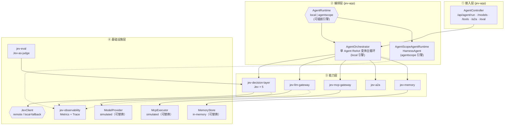
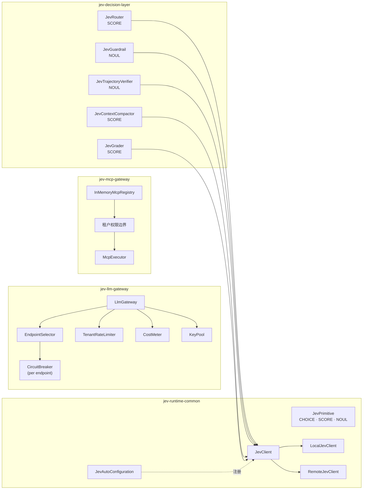
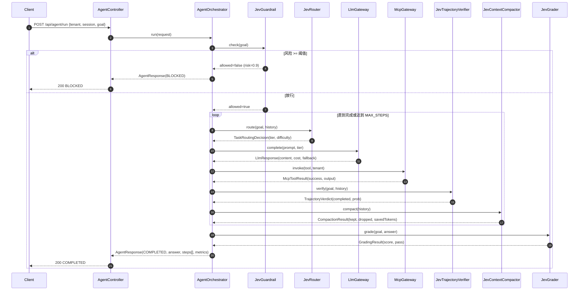
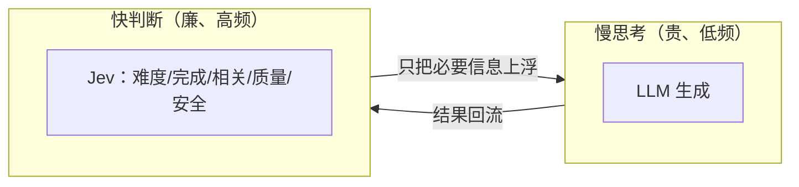
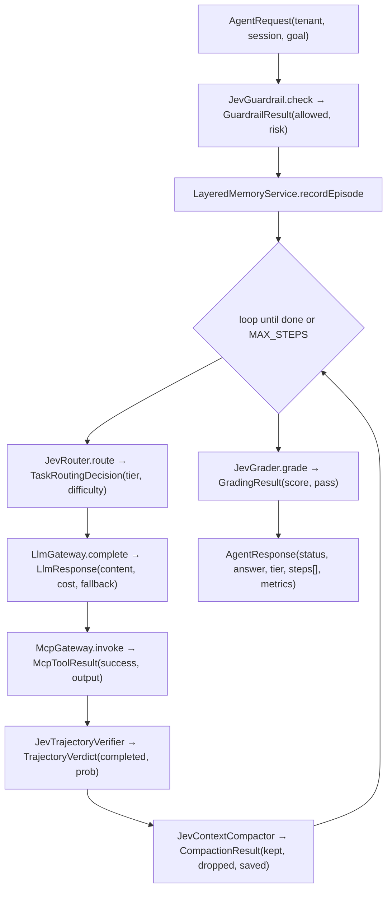
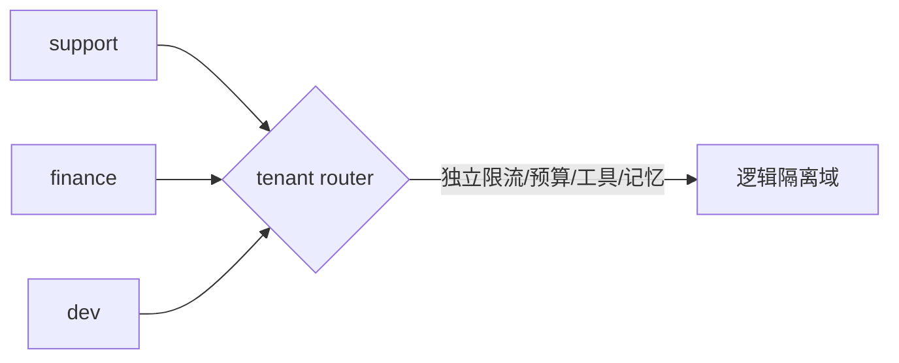
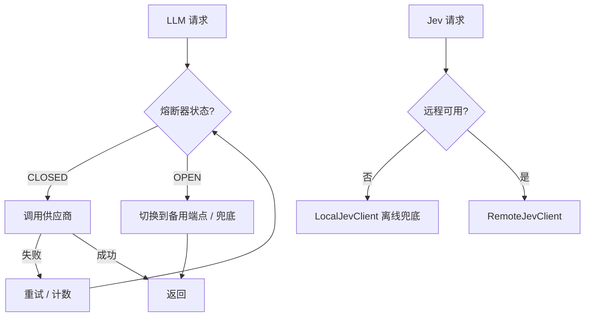

# 🏛 架构设计（ARCHITECTURE）

> 本文档描述 Jev Agent Runtime 的分层结构、组件职责、关键设计决策、数据流与扩展点。

## 目录

- [1. 总体分层](#1-总体分层)
- [2. 组件图](#2-组件图)
- [3. 一次运行的时序](#3-一次运行的时序)
- [4. 关键设计决策](#4-关键设计决策)
- [5. 数据流](#5-数据流)
- [6. 多租户隔离模型](#6-多租户隔离模型)
- [7. 容错与降级](#7-容错与降级)
- [8. 扩展点](#8-扩展点)

---

## 1. 总体分层

系统分为四层：**接入层 → 编排层 → 能力层 → 基础设施层**。

---

## 2. 组件图

---

## 3. 一次运行的时序

---

## 4. 关键设计决策

### 4.1 单 Agent 为核心 + 弹性多 Agent 补充
核心循环是单 Agent 的 **ReAct 变体**（reason → act → observe → verify）。只有当任务更适合专家时，才通过 A2A 目录发现并委派给 peer agent。
> 避免「盲目堆叠多 Agent」带来的 token 爆炸与协调成本。

### 4.2 决策下沉（Jev）与生成上浮（LLM）分离
每步的高频判断（难度、是否完成、相关性、质量、安全）全部由 **Jev** 完成，只有「生成」走 LLM。同一份上下文里，Jev 一次前向返回**类型化结果 + 校准置信度**。

### 4.3 网关作为控制面
所有对模型 / 工具的访问都必须经过 **LLM Gateway / MCP Gateway**，从而集中实现路由、限流、成本、权限、审计、可观测。

### 4.4 多租户隔离贯穿全链路
限流、预算、工具可见性、记忆分区都以 `tenantId` 为键。

### 4.5 默认离线可运行
所有外部依赖（Jev、模型供应商、MCP）都有**确定性兜底实现**，保证仓库 clone 即可端到端跑通；替换为真实实现只需换 Bean。

---

## 5. 数据流

---

## 6. 多租户隔离模型

| 维度 | 隔离手段 | 组件 |
|---|---|---|
| 流量 | 每租户固定窗口限流 | `TenantRateLimiter` |
| 成本 | 每租户预算，超支熔断 | `CostMeter` / `budget` |
| 工具 | 工具可见性按 `tenantId` 过滤 | `McpGateway` / 权限边界 |
| 记忆 | 记忆分区键含 `tenantId` | `LayeredMemoryService` |
| 指标 | 指标标签含 `tenant` | `AgentMetrics` |

---

## 7. 容错与降级

- **LLM 侧**：Resilience4j **每端点独立熔断器**，故障端点快速失败并切换备用端点；`llm_request_total{status="circuit_open"}` 可观测。
- **Jev 侧**：`fallback-local=true` 时使用确定性离线实现；远程不可用自动降级。

---

## 8. 扩展点

| 需求 | 替换点 |
|---|---|
| 接入真实 Jev | `jev.fallback-local=false` + `jev.api-key` |
| 接入真实模型 | 实现 `ModelProvider`，注册到 `LlmGateway` |
| 接入真实 MCP | 实现 `McpExecutor` / 对接 Nacos MCP Registry |
| 接入真实 A2A | `A2aDirectory.delegate` 换成 A2A JSON-RPC |
| 持久化记忆 | 实现 `MemoryStore`（Redis + 向量库） |
| 可观测增强 | `AgentMetrics` 增加 OTel span，`TraceRecorder` 导出 |

---

<a href="../README.md">← 返回 README</a>

