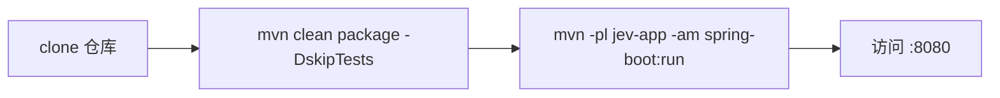
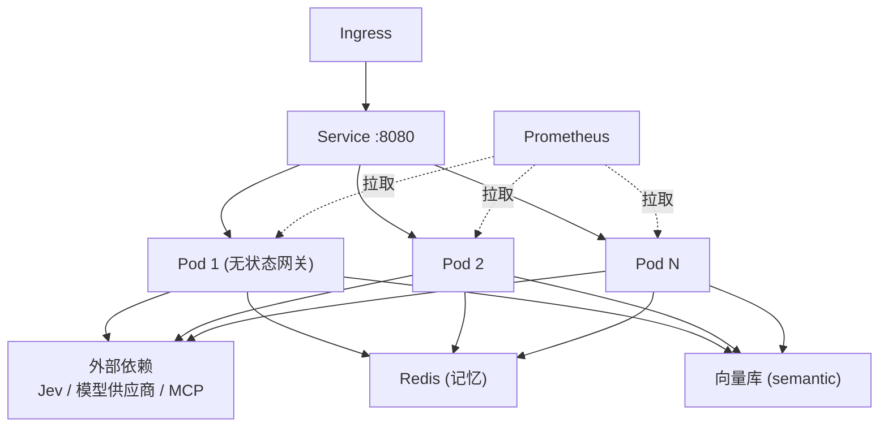

# 🚀 部署运维（DEPLOYMENT）

> 本文档说明本地、容器与生产环境的部署方式，以及监控告警与常见问题处置。

## 目录

- [1. 环境要求](#1-环境要求)
- [2. 本地部署](#2-本地部署)
- [3. 容器化部署](#3-容器化部署)
- [4. 生产部署（K8s）](#4-生产部署k8s)
- [5. 配置管理](#5-配置管理)
- [6. 监控与告警](#6-监控与告警)
- [7. 容量与性能](#7-容量与性能)
- [8. 常见运维问题](#8-常见运维问题)

---

## 1. 环境要求

| 项 | 最低 | 推荐 |
|---|---|---|
| JDK | 21 | 21 (LTS) |
| Maven | 3.9 | 3.9+ |
| 内存 | 512 MB | 2 GB+ |
| CPU | 1 核 | 2 核+ |

---

## 2. 本地部署



```bash
git clone https://cnb.cool/Zeek-2026/JevAgentRuntime.git
cd JevAgentRuntime
mvn -q clean package -DskipTests
mvn -pl jev-app -am spring-boot:run
```

或直接运行打包产物：

```bash
java -jar jev-app/target/jev-app-1.0.0.jar
```

---

## 3. 容器化部署

### 3.1 Dockerfile（多阶段构建）

```dockerfile
# ---- build stage ----
FROM maven:3.9-eclipse-temurin-21 AS build
WORKDIR /src
COPY . .
RUN mvn -q clean package -DskipTests

# ---- runtime stage ----
FROM eclipse-temurin:21-jre
WORKDIR /app
COPY --from=build /src/jev-app/target/jev-app-1.0.0.jar app.jar
EXPOSE 8080
ENTRYPOINT ["java","-XX:+UseZGC","-jar","app.jar"]
```

### 3.2 构建与运行

```bash
docker build -t jev-agent-runtime:1.0.0 .
docker run -d --name jev -p 8080:8080 \
  -e JEV_FALLBACK_LOCAL=true \
  jev-agent-runtime:1.0.0
```

### 3.3 Docker Compose（含 Prometheus）

```yaml
services:
  jev:
    build: .
    ports: ["8080:8080"]
    environment:
      JEV_FALLBACK_LOCAL: "true"
  prometheus:
    image: prom/prometheus
    ports: ["9090:9090"]
    volumes:
      - ./deploy/prometheus.yml:/etc/prometheus/prometheus.yml:ro
```

---

## 4. 生产部署（K8s）



要点：
- **无状态网关**：应用本身无状态，横向扩容即可提升吞吐；
- **就绪/存活探针**：使用 `/actuator/health`；
- **优雅停机**：`server.shutdown=graceful` + `timeout-per-shutdown-phase`；
- **配置外置**：环境变量 / ConfigMap 覆盖 `application.yml`。

### 探针示例

```yaml
livenessProbe:
  httpGet: { path: /actuator/health/liveness, port: 8080 }
readinessProbe:
  httpGet: { path: /actuator/health/readiness, port: 8080 }
```

---

## 5. 配置管理

| 配置项 | 环境变量 | 默认 | 说明 |
|---|---|---|---|
| 端口 | `SERVER_PORT` | 8080 | 服务端口 |
| Jev 远程地址 | `JEV_BASE_URL` | — | 远程 Jev 地址 |
| Jev Key | `JEV_API_KEY` | 空 | 留空用离线兜底 |
| 离线兜底 | `JEV_FALLBACK_LOCAL` | true | `false` 走远程 |
| Jev 超时 | `JEV_TIMEOUT_MS` | 2000 | 毫秒 |
| 路由阈值 | `JEV_THRESHOLD` | 0.5 | 难度判定阈值 |
| 限流阈值 | `JEV_GATEWAY_RATE_LIMIT_PER_WINDOW` | 120 | 每窗口请求数 |
| 预算 | `JEV_GATEWAY_DEFAULT_BUDGET_USD` | 5.0 | 每租户预算 |
| 供应商超时 | `JEV_GATEWAY_PROVIDER_TIMEOUT_MS` | 15000 | 毫秒 |

> 生产环境敏感项（如 `JEV_API_KEY`）应通过密钥管理下发，切勿硬编码。

---

## 6. 监控与告警

### 6.1 Prometheus 抓取

```yaml
scrape_configs:
  - job_name: jev-agent-runtime
    metrics_path: /actuator/prometheus
    static_configs:
      - targets: ["jev:8080"]
```

### 6.2 建议告警规则

| 告警 | 条件 | 说明 |
|---|---|---|
| 高熔断率 | `rate(llm_request_total{status="circuit_open"}[5m]) > 0` | 供应商异常 |
| 高护栏拦截 | `rate(guardrail_block_total[5m])` 突增 | 疑似攻击 |
| 高决策延迟 | `histogram_quantile(0.99, jev_decision_latency)` 超阈 | Jev 变慢 |
| 预算濒临 | 租户累计成本接近预算 | 成本管控 |

### 6.3 关键指标

见 [README 可观测章节](../README.md#-可观测与指标)。

---

## 7. 容量与性能

| 维度 | 手段 |
|---|---|
| 并发 | Java 21 虚拟线程；水平扩容 |
| 延迟 | Jev 决策下沉；端点熔断快速失败 |
| 成本 | 难度路由；上下文压缩；预算熔断 |
| 稳定性 | 熔断 + 兜底；无状态可水平扩展 |

---

## 8. 常见运维问题

| 现象 | 可能原因 | 处置 |
|---|---|---|
| 启动失败找不到 JevClient | 自动配置未加载 | 检查 `.imports` 文件（见 BUGFIX #2） |
| 正常请求被拦截 | 护栏误判 | 检查关键词逻辑（见 BUGFIX #3） |
| 大量 `circuit_open` | 供应商故障 | 检查上游可达性 / 调熔断参数 |
| 429 限流 | 租户超阈值 | 调整 `rate-limit-per-window` |
| 指标缺失 | Actuator 未暴露 | 检查 `management.endpoints` 配置 |

---

<p align="right"><a href="../README.md">← 返回 README</a></p>
