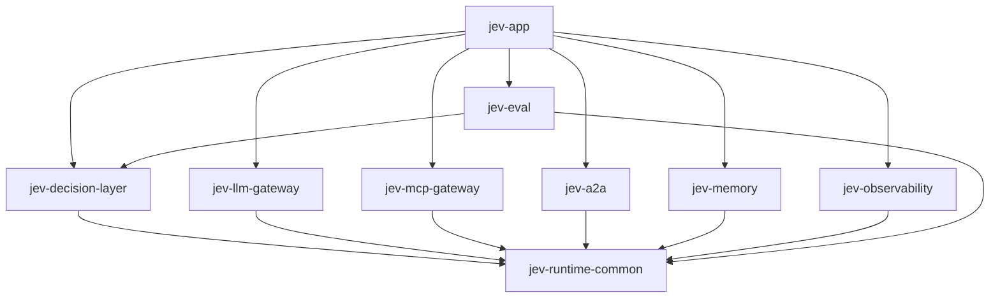
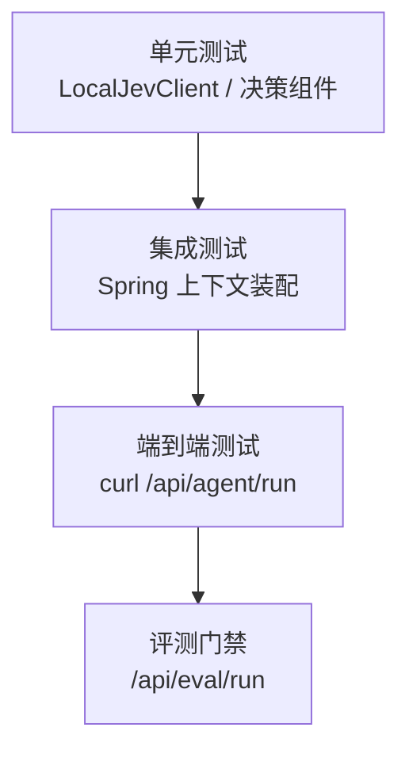

# 👨‍💻 开发指南（DEVELOPMENT）

> 本文档面向贡献者与二次开发者：环境搭建、模块依赖、扩展点、测试与编码约定。

## 目录

- [1. 环境搭建](#1-环境搭建)
- [2. 模块依赖关系](#2-模块依赖关系)
- [3. 代码结构](#3-代码结构)
- [4. 扩展指南](#4-扩展指南)
- [5. 测试](#5-测试)
- [6. 编码约定](#6-编码约定)
- [7. 提交规范](#7-提交规范)

---

## 1. 环境搭建

```bash
# 克隆
git clone https://cnb.cool/Zeek-2026/JevAgentRuntime.git
cd JevAgentRuntime

# 全量构建（跳过测试加速）
mvn -q clean package -DskipTests

# 运行测试
mvn -q clean test

# 本地启动
mvn -pl jev-app -am spring-boot:run
```

IDE 建议：IntelliJ IDEA，确保 Project SDK = 21，Maven 自动导入。

---

## 2. 模块依赖关系



- `jev-runtime-common` 是被广泛依赖的**基础域模型 + Jev 客户端**；
- `jev-app` 是唯一可运行的聚合模块（依赖全部能力模块）；
- 能力模块之间尽量**不互相依赖**，通过 common 的接口通信。

---

## 3. 代码结构

```
jev-runtime-common/
└── src/main/java/com/jev/runtime/common/
    ├── JevPrimitive.java          # CHOICE / SCORE / NOUL
    ├── JevRequest.java            # 原语请求
    ├── JevDecision.java           # 决策结果
    ├── JevClient.java             # 客户端接口
    ├── LocalJevClient.java        # 离线确定性兜底
    ├── RemoteJevClient.java       # 远程实现
    ├── JevAutoConfiguration.java  # Spring 自动配置
    └── dto/                       # AgentRequest / AgentResponse 等

jev-decision-layer/
└── com/jev/runtime/decision/
    ├── JevRouter.java
    ├── JevGuardrail.java
    ├── JevTrajectoryVerifier.java
    ├── JevContextCompactor.java
    └── JevGrader.java

jev-llm-gateway/
└── com/jev/runtime/llm/
    ├── LlmGateway.java
    ├── EndpointSelector.java
    ├── ModelProvider.java
    ├── CostMeter.java
    ├── TenantRateLimiter.java
    └── KeyPool.java

jev-app/
└── com/jev/runtime/app/
    ├── JevAgentRuntimeApplication.java
    ├── AgentOrchestrator.java     # 单 Agent 主循环
    └── web/AgentController.java   # REST 端点
```

---

## 4. 扩展指南

### 4.1 接入真实 Jev

```yaml
jev:
  fallback-local: false
  api-key: ${JEV_API_KEY}
  base-url: https://api.typesafe.ai/v1
```

无需改代码：`JevAutoConfiguration` 会按配置装配 `RemoteJevClient`。

### 4.2 接入真实模型供应商

实现 `ModelProvider` 接口并注册为 Bean：

```java
@Component
public class OpenAiProvider implements ModelProvider {
    @Override
    public String id() { return "openai"; }

    @Override
    public LlmResponse complete(LlmRequest req) {
        // 调用真实 API
    }
}
```

`LlmGateway` 会自动通过 `EndpointSelector` 纳入路由与熔断。

### 4.3 接入真实 MCP

实现 `McpExecutor`（对接 Nacos MCP Registry），替换模拟实现即可，`McpGateway` 的权限边界逻辑无需改动。

### 4.4 持久化记忆

实现 `MemoryStore`：

```java
@Component
public class RedisMemoryStore implements MemoryStore {
    // working/episodic → Redis；semantic → 向量库
}
```

### 4.5 新增一个决策用途

1. 在 `jev-decision-layer` 新建组件，注入 `JevClient`；
2. 主构造器标注 `@Autowired`（避免 Spring 构造器歧义，见 BUGFIX #1）；
3. 在 `AgentOrchestrator` 合适位置调用，并记录 trace 步骤。

---

## 5. 测试

```bash
# 全部测试
mvn -q clean test

# 单模块
mvn -q -pl jev-decision-layer test

# 单个测试类
mvn -q -pl jev-runtime-common test -Dtest=LocalJevClientTest
```

测试分层：



> 注意：编写测试用例时避免**关键词歧义**（见 BUGFIX「测试用例歧义」），
> 例如 `choice` 原语测试中输入同时含多个候选关键词会导致得分相同。

---

## 6. 编码约定

| 项 | 约定 |
|---|---|
| 包名 | `com.jev.runtime.<module>` |
| DTO | 使用 Java `record`，不可变 |
| 注入 | 构造器注入；多构造器时主构造器标 `@Autowired` |
| 依赖方向 | 能力模块 → common，禁止反向依赖 |
| 日志 | 关键决策点打印结构化信息 |
| 异常 | 外部依赖异常必须被网关捕获并降级 |

---

## 7. 提交规范

采用 Conventional Commits：

```
feat:     新功能
fix:      缺陷修复
docs:     文档
refactor: 重构
test:     测试
chore:    构建/杂项
```

示例：`fix: guardrail only scans subject input to avoid false positives`

---

<p align="right"><a href="../README.md">← 返回 README</a></p>
