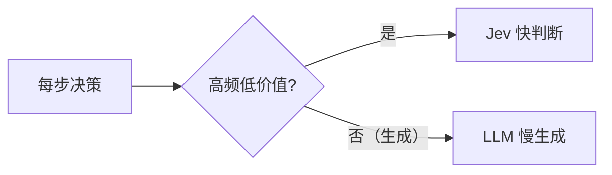

# ❓ 常见问题（FAQ）

> 汇总关于 Jev Agent Runtime 的高频疑问、设计取舍与排错指南。

## 目录

- [1. 项目定位](#1-项目定位)
- [2. Jev 相关问题](#2-jev-相关问题)
- [3. 单 Agent vs 多 Agent](#3-单-agent-vs-多-agent)
- [4. 运行与排错](#4-运行与排错)
- [5. 架构与扩展](#5-架构与扩展)
- [6. 面试相关](#6-面试相关)

---

## 1. 项目定位

**Q1：这个项目到底解决什么问题？**
A：多业务线接入 Agent 时的四大痛点：**成本失控、工具治理缺失、多租户难隔离、不可观测**。
运行时把「模型路由、工具治理、租户隔离、可观测、评测」收拢为一个统一控制面。

**Q2：为什么是「运行时/网关」而不是一个 Agent 应用？**
A：Agent 应用是「用」Agent，本项目是「管」Agent——属于**基础设施/中间件**类项目，
技术含量与可深挖空间更大，也更贴合 Java 后端岗位。

---

## 2. Jev 相关问题

**Q3：没有 Jev API Key 能跑吗？**
A：**可以**。默认启用离线校准兜底（`LocalJevClient`），clone 即可端到端运行。

**Q4：离线兜底是不是"假的"？**
A：它是**确定性的本地启发式实现**，用于在无外部依赖时保持工程可运行、可测试、可演示。
接入真实 Jev 后即被 `RemoteJevClient` 替换，调用方代码零改动。

**Q5：Jev 和 LLM 有什么区别？**
A：Jev **不生成文本**，只返回类型化原语（`CHOICE`/`SCORE`/`NOUL` + 校准置信度），
定位是「快判断」；LLM 负责「慢生成」。二者是**分工**关系而非替代关系。

---

## 3. 单 Agent vs 多 Agent

**Q6：为什么默认单 Agent，而不是多 Agent？**
A：多 Agent 的收益常来自**算力堆叠**而非协作本身；盲目多 Agent 会带来 token 爆炸与协调成本。
本项目以单 Agent 为主线把链路做深，多 Agent 仅作为「弹性补充」经 A2A 委派。

**Q7：那什么时候用多 Agent？**
A：当任务确实需要**不同专长**（如 SQL 分析、代码审计）且单 Agent 上下文无法承载时，
通过 A2A 目录发现并委派给专家 Agent。

---

## 4. 运行与排错

**Q8：应用启动报 `No default constructor found`？**
A：这是已知历史缺陷（组件有多个构造器导致 Spring 歧义）。**当前代码已修复**（主构造器标 `@Autowired`）。
详见 [BUGFIX #1](BUGFIX.md)。

**Q9：正常请求也被 BLOCKED？**
A：历史缺陷（护栏把 instruction 文本也纳入风险词扫描）。**当前代码已修复**：只扫描被判定主体 `input`。
详见 [BUGFIX #3](BUGFIX.md)。

**Q10：`/api/agent/run` 返回 429？**
A：该租户触发了固定窗口限流。调整 `jev.gateway.rate-limit-per-window`。

**Q11：指标为空？**
A：检查 `management.endpoints.web.exposure.include` 是否包含 `prometheus`。

---

## 5. 架构与扩展

**Q12：怎么接入真实模型供应商？**
A：实现 `ModelProvider` 接口并注册为 Bean，网关会自动纳入路由与熔断。详见 [DEVELOPMENT](DEVELOPMENT.md)。

**Q13：怎么接入真实记忆存储？**
A：实现 `MemoryStore`（Redis + 向量库），替换内存实现。

**Q14：多租户是怎么隔离的？**
A：限流、预算、工具可见性、记忆分区、指标标签都以 `tenantId` 为键。详见 [ARCHITECTURE](ARCHITECTURE.md)。

**Q15：为什么把 WebFlux 换成了 RestClient？**
A：见 [TECH_STACK](TECH_STACK.md)「语言与运行时」——虚拟线程 + 阻塞 IO 已足够，降低心智负担与依赖面。

---

## 6. 面试相关

**Q16：这个项目能讲多久？**
A：属于基础设施类，可深挖点包括：Jev 决策下沉原理、网关控制面设计、多租户隔离、
熔断降级策略、虚拟线程高并发、可观测体系、评测门禁。**足以支撑 40 分钟深聊**。

**Q17：能量化哪些指标？**
A：并发/QPS、P99 延迟、**模型路由成本下降 %**、**上下文压缩比 / 节省 token 数**、
任务成功率、评测通过率、多租户隔离效果。

**Q18：相比普通 CRUD 项目优势在哪？**
A：涉及 **JVM/并发/IO/中间件设计**，而非简单增删改查；且踩过真实 Bug（自动配置、
构造器歧义、关键词误判），有可复述的工程故事。

---

<a href="../README.md">← 返回 README</a>

