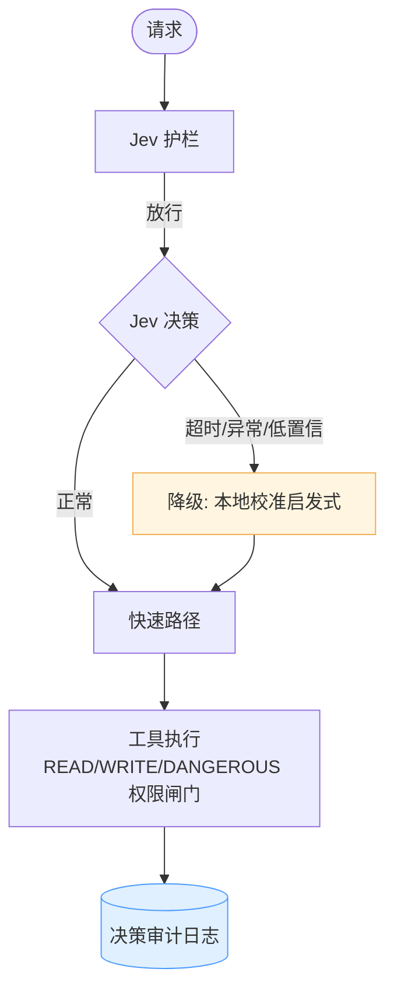
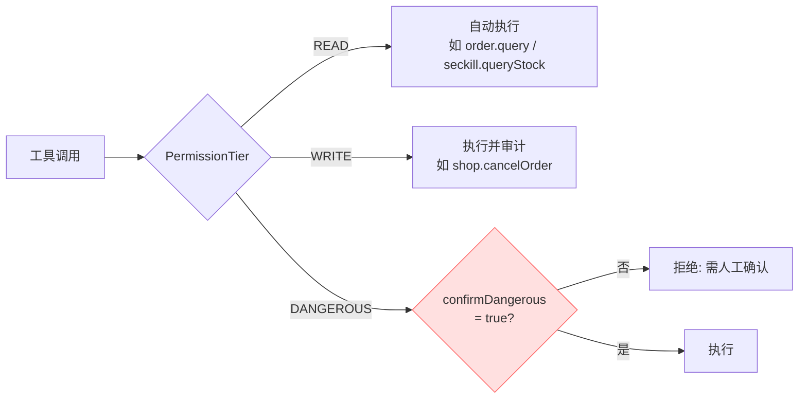

# 🛡 可靠性设计：降级、混沌演练与决策审计

> 本文档回答面试里最锋利的那类问题：**"Jev 挂了怎么办？"、"你怎么证明降级路径真的能用？"、"你怎么排查某次决策为什么是这个结果？"**

## 1. 三层防线



| 层 | 机制 | 组件 |
|---|---|---|
| ① 预防 | 护栏拦截危险/注入请求 | `JevGuardrail` |
| ② 降级 | 主 Jev 失败 → 本地校准兜底，**任务照常完成** | `ResilientJevClient` |
| ③ 审计 | 每个决策落日志：输入摘要、结果、置信度、来源、是否走了降级 | `DecisionAuditLog` |

## 2. Jev 弹性包装器（ResilientJevClient）

所有 Jev 调用都经过一个弹性包装器，它做三件事：

1. **透明降级**：主实现抛异常（超时、5xx、网络断）时，自动改用 `LocalJevClient`（确定性校准启发式）。调用方无感知。
2. **混沌开关**：`setChaos(true)` 后，每次决策都**主动**走降级路径——用来演练和证明降级真的有效，而不是纸面设计。
3. **审计埋点**：每次决策无论成败都写一条 `DecisionAuditRecord`。

```java
JevDecision decide(JevRequest req) {
    if (chaos) return audit(fallback.decide(req), chaos=true);
    try   { return audit(primary.decide(req)); }
    catch { return audit(fallback.decide(req), fallback=true); }
}
```

## 3. 混沌工程端点（Game-day）

```bash
# 打开混沌：注入 Jev 主实现失败
curl -X POST "http://localhost:8080/api/chaos/jev?enabled=true"
# 此时再跑 agent run：全部决策走降级，但任务仍 COMPLETED
# 关闭混沌
curl -X POST "http://localhost:8080/api/chaos/jev?enabled=false"
```

这是面试演示的**王牌环节**：现场把"决策模型挂了"演给面试官看，任务不中断，审计日志里 `fallbackRate` 立刻变化。端到端实测：混沌开启期间 `fallbackRate` 从 0 → 0.5，关闭后恢复。

## 4. 工具权限三级（Human-in-the-loop 落地）



- `READ`：无副作用，直接放行（`order.query`、`seckill.queryStock`）。
- `WRITE`：可逆业务操作，执行 + 审计（`shop.cancelOrder`）。
- `DANGEROUS`：不可逆/高影响（`billing.refund`），**必须**在请求 `context.confirmDangerous=true` 时才执行，否则拒绝并提示。

编排器把请求上下文里的 `confirmDangerous` 透传给 MCP 网关，由网关统一拦截——业务侧 Agent 无法绕过。

## 5. 决策审计日志（Decision Audit Log）

每个 Jev 决策落一条记录：

| 字段 | 含义 |
|---|---|
| `timestamp` / `primitive` | 决策时间、CHOICE/SCORE/NOUL |
| `instruction` / `inputPreview` | 指令与输入摘要（截断） |
| `value` / `score` / `probability` / `confidence` | 决策结果 |
| `latencyMs` / `source` | 耗时、来自 remote 还是 local-fallback |
| `fallback` / `chaos` | 是否走了降级、是否在混沌演练中 |

查询接口：

```bash
curl "http://localhost:8080/api/audit/decisions?limit=20"   # 最近的决策
curl "http://localhost:8080/api/audit/stats"                # 汇总: total/fallbacks/fallbackRate/chaosEvents
```

**一条审计日志同时喂饱三件事**：可观测（追决策质量）、评测（离线回放算准确率）、面试故事（"我靠审计日志发现某场景置信度普遍偏低，于是调了阈值"）。

## 6. 基准端点（Benchmark）

```bash
curl -X POST "http://localhost:8080/api/benchmark/tool-selection?iterations=20"
```

同一个有界决策（选工具）跑两遍：Jev 结构化决策 vs LLM 文本生成+解析，输出 P50/P95、加速比、相对成本、一致性。离线模式下 LLM 往返用真实延迟模拟（~180-260ms），实测 Jev P95≈0ms。

> 注意：官方宣称的 193×/444× 是厂商数字，本端点产出的才是"在我自己的数据集和环境里"的可信数字——接真实 Provider 后重跑即可。

## 7. 评测门禁（Eval as Release Gate）

```bash
curl -X POST http://localhost:8080/api/eval/run
```

黄金数据集逐条跑 Agent，Jev 评分，输出 passRate / meanScore。**阈值不达标 = 不允许发布**。离线阈值（0.45）按本地评分基线校准，接真实 Jev 后需重新标定。

---

*Author: 朱近涛 (Zhu Jintao) · zjt2706207152@outlook.com*
