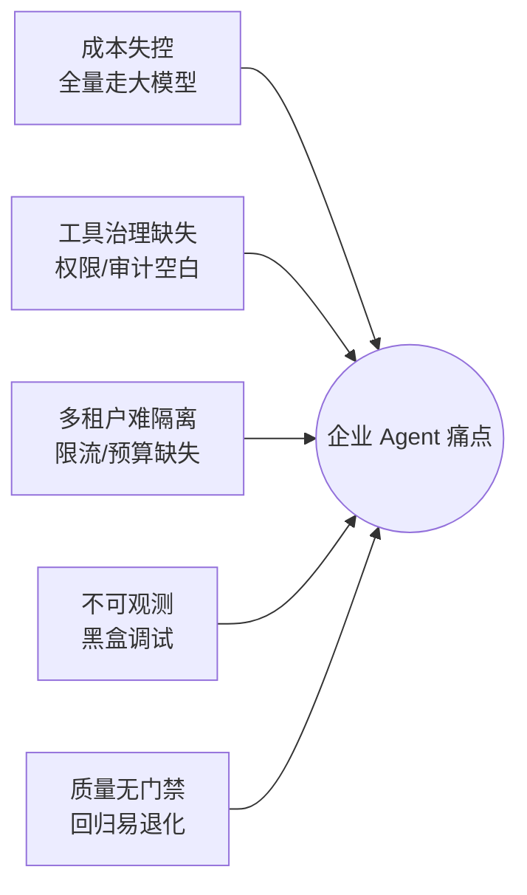
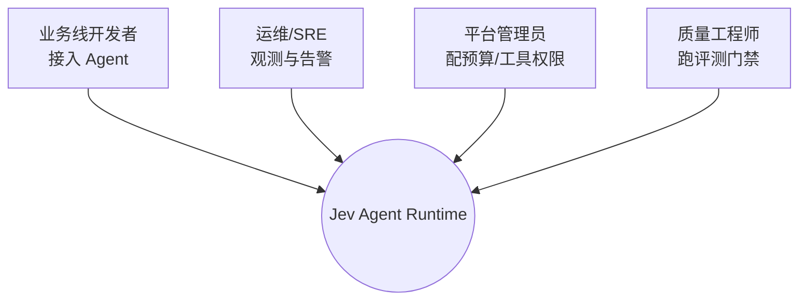
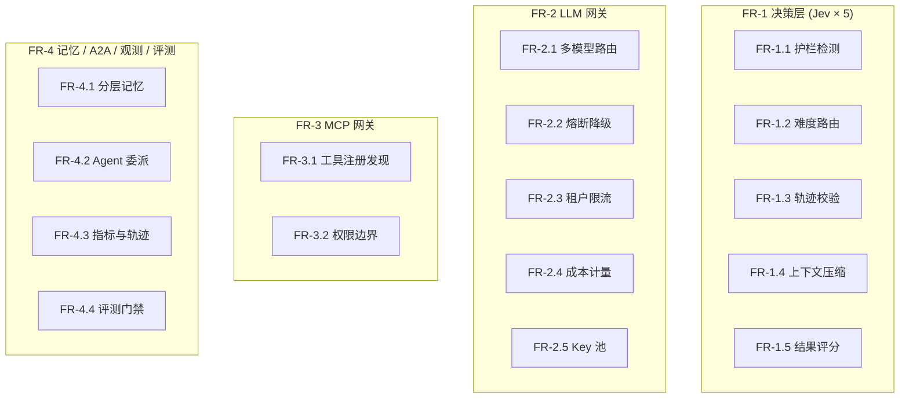
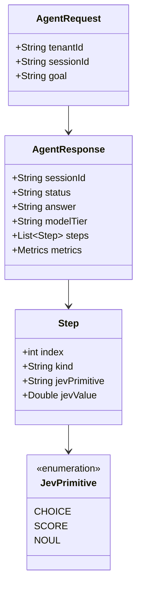

# 📋 需求文档（REQUIREMENTS）

> 本文档定义 Jev Agent Runtime 的背景、目标、功能与非功能需求、用例与验收标准。

## 目录

- [1. 背景与动机](#1-背景与动机)
- [2. 目标与非目标](#2-目标与非目标)
- [3. 角色与用例](#3-角色与用例)
- [4. 功能需求](#4-功能需求)
- [5. 非功能需求](#5-非功能需求)
- [6. 领域模型](#6-领域模型)
- [7. 验收标准](#7-验收标准)

---

## 1. 背景与动机

2026 年 AI Agent 进入企业落地期，但普遍痛点：

Jev（System One 决策模型）的出现提供了破局点：**把高频低价值的判断从 LLM 下沉到专用决策模型**，从而在保持质量的同时大幅降本提速。

---

## 2. 目标与非目标

### 2.1 目标（Goals）

| # | 目标 | 度量 |
|---|---|---|
| G1 | 统一 Agent 接入运行时 | 多业务线经统一 API 接入 |
| G2 | 模型路由降本 | 相对于全量走大模型，成本显著下降 |
| G3 | 工具治理 | 租户级工具可见性与调用审计 |
| G4 | 多租户隔离 | 限流/预算/记忆按租户隔离 |
| G5 | 可观测 | Prometheus 指标 + 决策轨迹 |
| G6 | 质量门禁 | Jev-as-judge 回归评测 |
| G7 | 开箱即用 | clone 即可端到端运行 |

### 2.2 非目标（Non-Goals）

- ❌ 不做通用 LLM 训练/微调
- ❌ 不做前端可视化大屏（当前以 REST + Swagger 为主）
- ❌ 不做商业级计费系统（仅演示级成本计量）

---

## 3. 角色与用例

### 3.1 角色

### 3.2 核心用例

| 用例 | 角色 | 描述 |
|---|---|---|
| UC1 运行 Agent 任务 | 开发者 | 提交 goal，获得结果与决策轨迹 |
| UC2 查看模型舰队 | 开发者 | 查看可用模型与档位 |
| UC3 查看租户工具 | 开发者 | 查看当前租户可见 MCP 工具 |
| UC4 注册/发现 A2A | 开发者 | 注册 peer agent，必要时委派 |
| UC5 观测指标 | 运维 | 拉取 Prometheus 指标 |
| UC6 运行评测门禁 | 质量 | 跑黄金数据集，获得通过率 |

---

## 4. 功能需求

### FR-1 决策层（Jev）

| 编号 | 需求 | 优先级 |
|---|---|---|
| FR-1.1 | 请求侧护栏：识别不安全/注入请求并拦截 | P0 |
| FR-1.2 | 难度评估并路由到模型档位（SMALL/MEDIUM/LARGE） | P0 |
| FR-1.3 | 轨迹校验：判断目标是否完成 | P0 |
| FR-1.4 | 上下文压缩：按相关性打分筛留历史 | P1 |
| FR-1.5 | 结果评分：对最终答案评分，用于门禁 | P1 |

### FR-2 LLM 网关

| 编号 | 需求 | 优先级 |
|---|---|---|
| FR-2.1 | 按档位选择模型端点 | P0 |
| FR-2.2 | 端点故障熔断 + 备用端点降级 | P0 |
| FR-2.3 | 每租户固定窗口限流 | P0 |
| FR-2.4 | 每租户成本计量与预算熔断 | P1 |
| FR-2.5 | 多 Key 池轮转 | P2 |

### FR-3 MCP 网关

| 编号 | 需求 | 优先级 |
|---|---|---|
| FR-3.1 | 工具注册、发现、调用 | P0 |
| FR-3.2 | 租户级工具可见性边界 | P0 |

### FR-4 记忆 / A2A / 观测 / 评测

| 编号 | 需求 | 优先级 |
|---|---|---|
| FR-4.1 | 分层记忆：working / episodic / semantic | P1 |
| FR-4.2 | Agent Card 注册与跨 Agent 委派 | P2 |
| FR-4.3 | 指标暴露 + 单次运行决策轨迹 | P0 |
| FR-4.4 | 黄金数据集 + Jev-as-judge 评测门禁 | P1 |

---

## 5. 非功能需求

| 类别 | 需求 | 目标 |
|---|---|---|
| 性能 | 单次决策延迟 | Jev 层毫秒级 |
| 并发 | 高并发 IO | 虚拟线程支撑 |
| 可靠性 | 外部依赖故障 | 熔断 + 兜底，不级联失败 |
| 可用性 | 零依赖启动 | clone 即可运行 |
| 安全 | 注入防护 | 护栏拦截 |
| 隔离 | 多租户 | 全链路 tenantId |
| 可维护 | 模块解耦 | 9 模块，接口注入 |
| 可观测 | 指标齐全 | 关键路径均有指标 |

---

## 6. 领域模型

---

## 7. 验收标准

| 编号 | 验收标准 | 状态 |
|---|---|---|
| AC-1 | `mvn clean package` 构建成功，产出 9 个 jar | ✅ |
| AC-2 | `mvn clean test` 全部通过 | ✅ |
| AC-3 | 应用启动，`/actuator/health` = UP | ✅ |
| AC-4 | 正常请求返回 `COMPLETED`，含完整轨迹 | ✅ |
| AC-5 | 注入请求返回 `BLOCKED`（risk ≥ 阈值） | ✅ |
| AC-6 | `/api/eval/run` 通过率 = 1.0 | ✅ |
| AC-7 | 无外部凭据即可端到端运行 | ✅ |

---

<a href="../README.md">← 返回 README</a>

