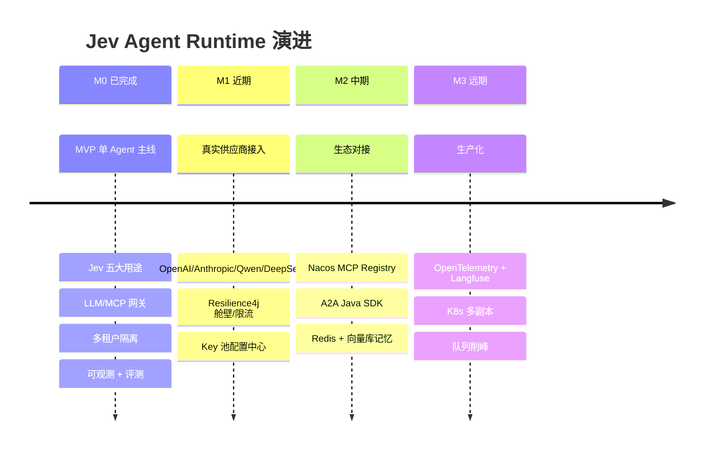
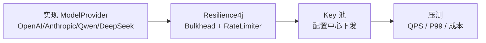

# 🗺 路线图（ROADMAP）

> 本文档描述项目从 MVP 到生产级的演进路线与里程碑。

## 目录

- [1. 演进总览](#1-演进总览)
- [2. 里程碑](#2-里程碑)
- [3. 详细规划](#3-详细规划)
- [4. 待办清单](#4-待办清单)

---

## 1. 演进总览

---

## 2. 里程碑

| 里程碑 | 目标 | 状态 |
|---|---|---|
| **M0** MVP | 单 Agent 端到端可运行，Jev × 5，网关，多租户，观测，评测 | ✅ 已完成 |
| **M1** 真实供应商 | 接入至少 2 家真实模型供应商 + 熔断/限流完善 | ⏳ 规划 |
| **M2** 生态对接 | MCP Registry、A2A SDK、持久化记忆 | 📋 待办 |
| **M3** 生产化 | 全链路追踪、K8s、削峰 | 📋 待办 |

---

## 3. 详细规划

### M0 — MVP（已完成）

- ✅ 9 个 Maven 模块
- ✅ Jev 五大用途：护栏 / 路由 / 校验 / 压缩 / 评分
- ✅ LLM 网关：多模型路由、每端点熔断、租户限流、成本计量
- ✅ MCP 网关：工具注册发现 + 租户权限边界
- ✅ 分层记忆 + A2A 目录
- ✅ Prometheus 指标 + 决策轨迹
- ✅ 评测门禁
- ✅ 3 个真实 Bug 修复（见 [BUGFIX](BUGFIX.md)）

### M1 — 真实供应商接入

- [ ] 实现 4 家供应商 `ModelProvider`
- [ ] 增加 Bulkhead（舱壁）线程隔离
- [ ] Key 池改为 Nacos/Apollo 下发
- [ ] 压测并沉淀量化指标

### M2 — 生态对接

- [ ] 对接 **Nacos MCP Registry**：存量 Java/HTTP 服务零改造发布为 MCP
- [ ] 接入 **A2A Java SDK**：进程内委派 → 标准 JSON-RPC
- [ ] 记忆持久化：Redis（working/episodic）+ 向量库（semantic）

### M3 — 生产化

- [ ] **OpenTelemetry** 全链路 span + **Langfuse** LLM 观测
- [ ] K8s 多副本 + 无状态网关 + HPA
- [ ] 队列削峰（突发流量）
- [ ] 多区域部署与容灾

---

## 4. 待办清单

| 类别 | 事项 | 优先级 |
|---|---|---|
| 供应商 | OpenAI 适配 | P0 |
| 供应商 | DeepSeek / Qwen 适配 | P0 |
| 容错 | Bulkhead 舱壁 | P1 |
| 容错 | 细粒度 RateLimiter | P1 |
| 记忆 | Redis MemoryStore | P1 |
| 记忆 | 向量库 semantic | P2 |
| 工具 | Nacos MCP Registry | P1 |
| 互通 | A2A Java SDK | P2 |
| 观测 | OTel + Langfuse | P1 |
| 部署 | K8s 编排 + HPA | P1 |
| 安全 | 更完善的注入检测 | P1 |
| 文档 | API 示例补全 | P2 |

---

<a href="../README.md">← 返回 README</a>

