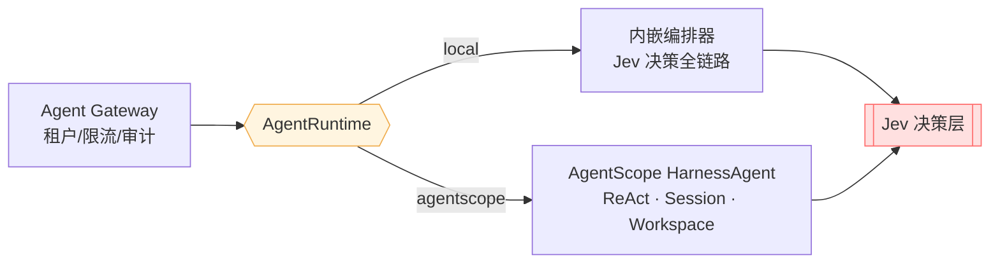

# 🔌 可插拔运行时（Pluggable Agent Runtime）

> 本文档说明 Jev Agent Runtime 的执行引擎抽象：`runtime.engine=local | agentscope` 的设计动机、两种引擎的分工、切换方式，以及"运行时绑定框架，但治理层不绑定"这条核心原则。

## 1. 为什么要做一层运行时抽象

面试里一定会被追问："你的 Agent 编排为什么自己写？为什么不用 LangGraph / AgentScope？"

直接回答"我自己写了一个编排器"很容易被下一个问题问穿：**那你的 Session 持久化、Tool 调用重试、Human-in-the-loop、沙箱、多 Agent 协作呢？**

本项目的答案是：



- **引擎是可替换的**：默认 `local`（自研编排，教学/演示友好），`agentscope` 把 Agent 生命周期交给生产级框架。
- **治理层是恒定的**：无论走哪条引擎，Jev 护栏、决策审计、评测门禁、工具权限都**先于**引擎生效、贯穿**始终**。
- 这就是"删重复轮子"的落地方式：运行时交给框架，差异化能力（Jev 决策、网关治理、业务 Tool、稳定性）自己握在手里。

## 2. 两种引擎的分工

| 维度 | `local`（默认） | `agentscope` |
|---|---|---|
| 定位 | 自研编排教学实现，**零外部依赖、离线可跑** | 生产级 Agent 框架 |
| Agent 生命周期 | `AgentOrchestrator` 手写 ReAct 变体 | `HarnessAgent`（ReAct + Session + Workspace） |
| Session / Memory | 进程内 / 可插 Redis | 框架内置持久化 |
| Human-in-the-loop | 工具权限三级 + 人工确认参数 | 框架事件流 + 本项目权限闸门叠加 |
| 工具调用 | `McpGateway`（本项目实现） | 框架 Tool 机制 + 本项目 MCP 网关 |
| 适用场景 | 离线演示、单测、教学 | 接真实模型 API Key 的生产链路 |

> 关键不变量：**Jev 治理层在两种引擎下行为完全一致**——护栏先拦、审计全记、评测门禁同标准。

## 3. 切换方式

```yaml
# application.yml
runtime:
  engine: local          # 或 agentscope
  agentscope:
    model: dashscope:qwen-plus
    workspace: .agentscope/workspace
    timeout-seconds: 120
```

切到 AgentScope 需要模型厂商 API Key（如 `DASHSCOPE_API_KEY`）。装配是**条件注入**的：Spring 根据 `runtime.engine` 决定注入 `LocalAgentRuntime` 还是 `AgentScopeAgentRuntime`，二者实现同一个 `AgentRuntime` 接口，控制器无感知。

```java
public interface AgentRuntime {
    AgentResponse run(AgentRequest request);
    String engine();   // "local" | "agentscope"
}
```

`AgentScopeAgentRuntime` 内部仍做三件事：① Jev 护栏先行；② 调 `HarnessAgent.call(...)`；③ Jev 评分 + 记录审计。框架失败时**降级到本地引擎**，绝不让请求跟着引擎一起死。

## 4. 设计决策

**为什么用接口而不是直接依赖 HarnessAgent？** 把引擎收敛到一个接口后面，换来的是：可测试（local 引擎跑全部单测）、可回滚（agentscope 出问题一键切回 local）、可讲故事（"我考虑过框架绑定风险"）。

**为什么不直接用 Spring AI 自己拼？** 见 [FAQ](FAQ.md)。简言之：Harness 工程化层（Session、Workspace、Human-in-the-loop 事件、子 Agent）在 AgentScope 是内置的，Spring AI 需要自己补这些。

## 5. 扩展点

- **新增引擎**：实现 `AgentRuntime` + 一个 `@Configuration`（`@ConditionalOnProperty(name="runtime.engine", havingValue="...")`）即可，不动控制器。
- **多引擎并行灰度**：未来可在网关层按 tenant / 流量比例路由到不同引擎做 A/B。

---

*Author: 朱近涛 (Zhu Jintao) · zjt2706207152@outlook.com*
