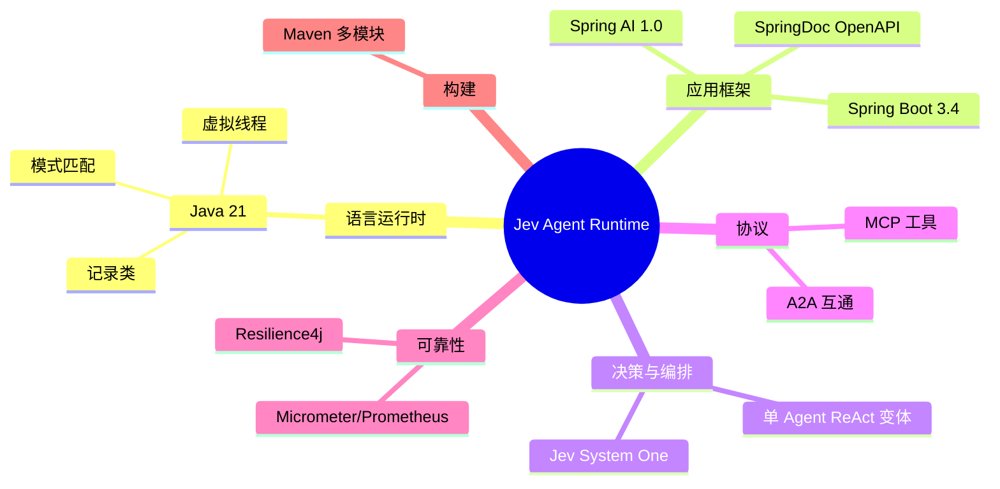

# 🛠 技术选型（TECH_STACK）

> 本文档说明每一项技术的选型理由、替代方案与取舍，便于面试深挖。

## 目录

- [1. 总览](#1-总览)
- [2. 语言与运行时](#2-语言与运行时)
- [3. 应用框架](#3-应用框架)
- [4. Agent 编排](#4-agent-编排)
- [5. 决策模型：Jev](#5-决策模型jev)
- [6. 工具协议：MCP](#6-工具协议mcp)
- [7. Agent 互通：A2A](#7-agent-互通a2a)
- [8. 容错：Resilience4j](#8-容错resilience4j)
- [9. 可观测](#9-可观测)
- [10. 构建与文档](#10-构建与文档)
- [11. 版本矩阵](#11-版本矩阵)

---

## 1. 总览

---

## 2. 语言与运行时

| 项 | 选型 | 理由 |
|---|---|---|
| 语言 | **Java 21 (LTS)** | 虚拟线程（高并发 IO 密集场景）、record（不可变 DTO）、switch 模式匹配 |
| 并发模型 | **虚拟线程** + 阻塞式 IO | Agent 场景是大量 IO 等待，虚拟线程可用同步代码获得高吞吐，避免响应式复杂度 |

**为什么不用 WebFlux？**
本项目过程中曾引入 WebFlux（`WebClient`），后**统一收敛为 `RestClient` + 虚拟线程**：
- 减少响应式编程的心智负担；
- Java 21 虚拟线程已能优雅处理 IO 密集并发；
- 移除 `spring-boot-starter-webflux` 依赖，降低依赖面。

> 取舍：极端高并发（百万连接）场景 WebFlux 仍有优势，属于后续可选演进。

---

## 3. 应用框架

| 项 | 选型 | 理由 |
|---|---|---|
| 应用框架 | **Spring Boot 3.4** | 自动配置、Actuator、`@ConfigurationProperties` 类型安全配置 |
| 依赖注入 | Spring IoC | 组件按接口注入，便于替换真实实现 |
| Web | **Spring MVC**（虚拟线程） | 与阻塞式 IO 一致，REST 语义清晰 |
| 参数校验 | Jakarta Bean Validation | 请求 DTO 校验 |
| 接口文档 | **SpringDoc OpenAPI** | 自动生成 Swagger UI |

---

## 4. Agent 编排

| 项 | 选型 | 理由 |
|---|---|---|
| 编排范式 | **单 Agent ReAct 变体** | 主线清晰、可解释、token 可控 |
| 多 Agent | **A2A 弹性补充** | 只在必要时委派，避免堆叠 |
| 框架依赖 | Spring AI 1.0 概念 + 自研编排器 | 保留对模型抽象的理解，同时把控制权握在自己手里 |

**为什么自研编排器而非直接用 LangChain4j / Spring AI Agent？**
- 本项目核心价值是**决策层下沉**（Jev）与**网关控制面**，需要精细控制每一步；
- 自研编排器便于插入 Jev 的五类判断与 trace 记录；
- Spring AI 作为模型抽象层保留，可平滑接入。

---

## 5. 决策模型：Jev

| 项 | 说明 |
|---|---|
| 定位 | **System One 决策模型**，不生成文本，只输出类型化原语 |
| 原语 | `CHOICE`（选择）、`SCORE`（评分 [0,1]）、`NOUL`（校准布尔概率） |
| 优势 | 快（官方 ~193×）、便宜（官方 ~1/444.6）、输出免费 |
| 接入 | `JevClient` 接口 → `RemoteJevClient` / `LocalJevClient` |
| 兜底 | 离线**确定性校准实现**，保证无外部依赖即可运行 |

> ⚠️ Jev 官方 API 尚未对中国大陆开放；本项目默认使用离线兜底，接入真实 Jev 只需配置。

---

## 6. 工具协议：MCP

| 项 | 说明 |
|---|---|
| 协议 | **Model Context Protocol** |
| 用途 | 工具注册 / 发现 / 调用，租户级权限边界 |
| 当前实现 | `InMemoryMcpRegistry` + 模拟 `McpExecutor` |
| 生产 | 对接 **Nacos MCP Registry**，把存量 Java/HTTP 服务零改造发布为 MCP |

---

## 7. Agent 互通：A2A

| 项 | 说明 |
|---|---|
| 协议 | **Agent2Agent (A2A)** |
| 用途 | Agent Card 注册发现、跨 Agent 委派 |
| 当前实现 | `A2aDirectory`（进程内）+ `AgentCard` |
| 生产 | 接入 **A2A Java SDK**，委派改为标准 JSON-RPC |

---

## 8. 容错：Resilience4j

| 项 | 说明 |
|---|---|
| 库 | **Resilience4j 2.2** |
| 模式 | **每供应商端点独立熔断器**（CircuitBreaker） |
| 理由 | 单个供应商故障不影响全局；快速失败 + 切换备用端点 |
| 可观测 | `llm_request_total{status="circuit_open"}` |
| 后续 | 增加舱壁（Bulkhead）、限流（RateLimiter）细粒度控制 |

---

## 9. 可观测

| 项 | 选型 | 理由 |
|---|---|---|
| 指标门面 | **Micrometer** | 与 Spring Boot 原生集成 |
| 指标后端 | **Prometheus** | 拉取式、生态成熟 |
| 健康检查 | **Spring Boot Actuator** | `/actuator/health` |
| 决策轨迹 | **TraceRecorder**（自研） | 每次运行记录每一步决策 |
| 后续 | OpenTelemetry 全链路 span + Langfuse | 生产级链路追踪与 LLM 观测 |

---

## 10. 构建与文档

| 项 | 选型 | 理由 |
|---|---|---|
| 构建 | **Maven 多模块** | 模块边界显式、依赖清晰 |
| 模块数 | 9 | 见 README 模块表 |
| 版本管理 | 父 POM `dependencyManagement` | 统一版本 |
| 文档 | Markdown + **Mermaid** | 图与代码同源，易维护 |

---

## 11. 版本矩阵

| 组件 | 版本 |
|---|---|
| JDK | 21 |
| Spring Boot | 3.4.1 |
| Spring AI | 1.0.0 |
| Resilience4j | 2.2.0 |
| Micrometer | 随 Boot |
| Maven | 3.9+ |

---

<a href="../README.md">← 返回 README</a>

