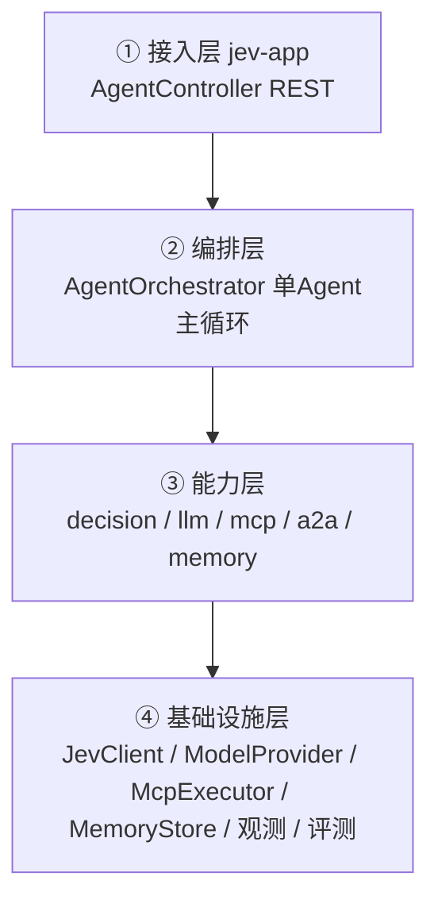
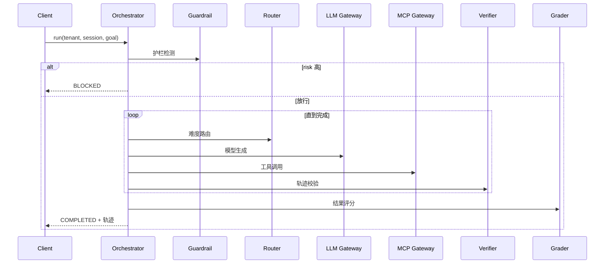
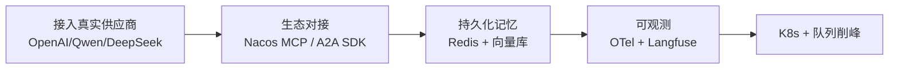

# 🧩 项目深挖面试题 — Jev Agent Runtime

> 面试官会围绕简历项目连续追问。本文按「项目全景 → 架构 → 技术细节 → 难点 → 权衡 → 延伸」组织，
> **每题给出参考答案 + 可能的追问**，帮助你准备 40 分钟以上的深聊。

---

## 目录

- [Part 1 项目全景](#part-1-项目全景)
- [Part 2 架构设计](#part-2-架构设计)
- [Part 3 核心技术细节](#part-3-核心技术细节)
- [Part 4 难点与踩坑](#part-4-难点与踩坑)
- [Part 5 技术权衡](#part-5-技术权衡)
- [Part 6 高并发与扩展](#part-6-高并发与扩展)
- [Part 7 延伸追问](#part-7-延伸追问)

---

## Part 1 项目全景

### Q1.1 用一分钟介绍一下这个项目。

**参考答案（结论先行）：**
「这是一个**面向企业的 Agent 运行时（Agent Runtime / 智能体网关）**，用 Java 21 + Spring Boot 构建。
它解决的核心问题是：企业接入 AI Agent 时普遍存在的**成本失控、工具治理缺失、多租户难隔离、不可观测**。
技术上最大的特点是**把高频低价值的决策从大模型下沉到一个专用决策模型 Jev**，
让每步的『难度判断、是否完成、相关性、安全』都由 Jev 毫秒级完成，只有『生成』才走 LLM，从而大幅降本提速。
工程上是 9 个 Maven 模块，默认离线可跑，clone 即可端到端演示。」

**追问：你的角色？** 独立设计并实现全部模块（架构、编码、测试、文档）。

**追问：项目规模？** 9 个 Maven 子模块、69 个 Java 文件，含单元/集成/端到端测试。

---

### Q1.2 为什么做「运行时/网关」，而不是直接做一个 Agent 应用？

**参考答案：**
「Agent 应用是『用』Agent，本质是业务编排；而**运行时是『管』Agent**，属于**基础设施/中间件**层次。
选这个方向有三个原因：
1. **可深挖**：涉及模型路由、熔断降级、多租户隔离、可观测，都是后端硬核考点；
2. **贴合 Java 生态**：网关 / 限流 / 熔断 / 控制面正是 Java 后端的强项；
3. **差异化**：市面上大量 Agent 项目是 Python 的 Demo，一个 Java 企业级运行时更能体现后端工程能力。

**追问：为什么不用现成的网关（如 Spring Cloud Gateway）？**
借鉴其思想，但 Agent 流量的治理维度不同（成本、token、模型档位、工具权限），需要自研控制面。」

---

### Q1.3 这个项目的核心亮点是什么？面试官最该记住哪三个点？

**参考答案：**
1. **决策下沉（Jev）+ 生成上浮（LLM）分离** —— 这是性能与成本的关键；
2. **网关作为控制面** —— 所有模型/工具访问收敛，集中实现路由/限流/成本/权限/审计；
3. **单 Agent 为主线 + 多 Agent 弹性补充** —— 避免 token 爆炸的务实多 Agent 观。

---

## Part 2 架构设计

### Q2.1 整体架构分几层？各层职责？

**参考答案：**

- **接入层**：统一 REST API（run/models/tools/a2a/eval）；
- **编排层**：单 Agent ReAct 变体主循环（guardrail→route→act→tool→verify→compact→grade）；
- **能力层**：决策、LLM 网关、MCP 网关、A2A、记忆五类能力；
- **基础设施层**：外部依赖的抽象与离线兜底实现。

**追问：为什么分层？** 关注点分离 + 接口注入，替换真实实现只需换 Bean。

---

### Q2.2 一次请求的完整链路是怎样的？

**参考答案：**

**追问：为什么护栏要在最前面？** 尽早拦截恶意/注入请求，避免浪费下游模型成本。

---

### Q2.3 Jev 和 LLM 各自负责什么？为什么要分离？

**参考答案：**
- **Jev（System One）**：不生成文本，返回类型化原语 `CHOICE / SCORE / NOUL` + 校准置信度，负责**高频判断**；
- **LLM**：负责**低频生成**（真正产出内容）。

分离的意义：每步的「难度/完成/相关/安全」判断调用量极大且不需要生成能力，
用专用小模型（官方数据：快约 193×、便宜约 444×）替代大模型，**在质量几乎不降的前提下大幅降本提速**。

**追问：Jev 的 NOUL 是什么？** 校准布尔概率（Normalized Output with Uncertainty Level），即「是/否」+ 置信度。

---

## Part 3 核心技术细节

### Q3.1 决策层（jev-decision-layer）有哪五个组件？

**参考答案：**
| 组件 | 原语 | 职责 |
|---|---|---|
| `JevGuardrail` | NOUL | 判断输入是否不安全/注入，决定是否拦截 |
| `JevRouter` | SCORE | 评估任务难度，路由到模型档位 |
| `JevTrajectoryVerifier` | NOUL | 判断目标是否已完成（决定循环是否结束） |
| `JevContextCompactor` | SCORE | 对历史打分，保留高相关的，压缩上下文 |
| `JevGrader` | SCORE | 对最终答案评分，用于质量门禁 |

**追问：如果 Jev 挂了怎么办？** `LocalJevClient` 离线确定性兜底，保证可用性（见 Part 4）。

---

### Q3.2 上下文压缩（Compactor）怎么实现的？省了什么？

**参考答案：**
对历史每一轮用 Jev 打「相关性分」，按分数排序保留 Top-K，其余丢弃，仅保留摘要。
指标 `compactionSavedTokens` 记录节省的 token。
**收益**：长会话下显著减少送入 LLM 的 token 数 → 降本 + 降延迟。

**追问：什么时候不触发？** 历史条数未超过 `keepTopK` 阈值（默认 8）时不丢弃，故短会话 savedTokens=0。

---

### Q3.3 LLM 网关做了哪些事？

**参考答案：**
1. **多模型路由**：按难度档位（SMALL/MEDIUM/LARGE）选端点；
2. **熔断降级**：Resilience4j **每端点独立熔断器**，故障端点快速失败并切备用；
3. **租户限流**：固定窗口限流，按 `tenantId` 隔离；
4. **成本计量**：按 token 计费，累计到租户预算，超支熔断；
5. **Key 池**：多 Key 轮转。

**追问：为什么每端点独立熔断而非全局？** 单个供应商故障不应拖垮全局；独立熔断 + 备用切换提升整体可用性。

---

### Q3.4 MCP 网关的租户权限边界怎么做的？

**参考答案：**
工具注册时标注可见租户；`McpGateway` 查询时按当前 `tenantId` 过滤，返回该租户**可见**的工具集。
调用时再次校验归属，防止越权。体现在 `GET /api/tools?tenantId=finance` 返回 finance 专属工具。

---

### Q3.5 多租户是怎么隔离的？

**参考答案：**
以 `tenantId` 为键贯穿全链路：

| 维度 | 手段 | 组件 |
|---|---|---|
| 流量 | 每租户固定窗口限流 | `TenantRateLimiter` |
| 成本 | 每租户预算 + 超支熔断 | `CostMeter` |
| 工具 | 可见性按租户过滤 | `McpGateway` |
| 记忆 | 记忆分区含 tenantId | `LayeredMemoryService` |
| 指标 | 指标标签含 tenant | `AgentMetrics` |

---

## Part 4 难点与踩坑

### Q4.1 你在项目中遇到过哪些真实 Bug？怎么定位的？

**参考答案（这是加分项，务必讲清）：**

**Bug 1 — 应用启动失败：`No default constructor found`**
- 现象：5 个决策组件启动即报错；
- 根因：每个组件有**两个 public 构造器**（便捷 + 完整），Spring 无法判断注入哪个；
- 定位：看异常栈定位到构造器解析；
- 修复：主构造器标注 `@Autowired` 消歧义。

**Bug 2 — `JevClient` Bean 找不到**
- 根因：`@AutoConfiguration` 类**不参与组件扫描**，库模块必须在
  `META-INF/spring/org.springframework.boot.autoconfigure.AutoConfiguration.imports` 登记；
- 修复：新增该文件登记自动配置类。

**Bug 3 — 护栏恒拦截所有请求（含正常请求）**
- 现象：正常请求也返回 `BLOCKED`，risk 恒为 0.9；
- 根因：离线 `noul()` 把 **instruction 文本也纳入风险词扫描**，而 instruction 本身含
  "unsafe/injection/jailbreak" → 恒命中；
- 修复：只扫描被判定主体 `input`，用 instruction 语义词区分「安全判定/完成判定」。

**追问：从这三个 Bug 学到了什么？**
「① Spring 构造器注入要显式消歧义；② 自动配置必须登记 imports；
③ 关键逻辑要有**语义边界**，不能把『指令元数据』和『被判定数据』混在一起扫。」

---

### Q4.2 怎么写测试保证质量？

**参考答案：**
- **单元测试**：覆盖 `LocalJevClient` 三种原语、决策组件；
- **集成测试**：Spring 上下文装配（`contextLoads`）；
- **端到端**：curl 打 `/api/agent/run`，验证正常请求 COMPLETED、注入请求 BLOCKED；
- **评测门禁**：`/api/eval/run` 在黄金数据集上跑 Jev-as-judge，要求通过率达标。

**追问：测试用例踩过什么坑？**
「原语测试的输入同时含多个候选关键词导致得分相同、断言失败——改为**无歧义输入**。
教训：测试数据要避免关键词重叠。」

---

## Part 5 技术权衡

### Q5.1 为什么把 WebFlux 换成了 RestClient？

**参考答案：**
「最初用了 WebFlux（WebClient），后来**统一收敛为 RestClient + 虚拟线程**，原因：
1. Java 21 虚拟线程已能优雅处理 IO 密集并发，同步代码更易读；
2. 减少响应式编程的心智负担；
3. 移除 `spring-boot-starter-webflux` 降低依赖面。
**权衡**：极端高并发（百万连接）场景 WebFlux 仍有优势，列为后续可选演进。」

**追问：虚拟线程为什么适合 Agent 场景？** Agent 是大量 IO 等待（模型/工具调用），虚拟线程让「同步写法」获得高吞吐。

---

### Q5.2 为什么单 Agent 为主，而不是一上来就多 Agent？

**参考答案：**
「多 Agent 的收益常来自**算力堆叠**而非协作本身；盲目多 Agent 会带来 token 爆炸与协调成本。
我的策略是**单 Agent 把链路做深，多 Agent 作为弹性补充**：只有当任务确实需要不同专长、
单 Agent 上下文无法承载时，才通过 A2A 目录发现并委派专家 Agent。」

---

### Q5.3 默认离线兜底会不会显得「假」？

**参考答案：**
「不会。离线实现是**确定性的本地启发式**，目的是让仓库**无外部依赖即可端到端运行、可测试、可演示**。
它遵循与真实 Jev 完全相同的 `JevClient` 接口，接入真实 Jev 只需 `fallback-local=false` + api-key，
**调用方代码零改动**。这是『面向接口 + 可替换』设计的体现。」

---

## Part 6 高并发与扩展

### Q6.1 这个系统如何支撑高并发？

**参考答案：**
1. **无状态网关**：应用无状态，可水平扩容；
2. **虚拟线程**：IO 密集高并发；
3. **熔断快速失败**：避免线程被慢依赖拖死；
4. **限流**：按租户保护后端；
5. **缓存**：模型/工具元数据可缓存。

**追问：如果流量突增 10 倍？** 优先限流保护 + 水平扩容；进一步可引入**队列削峰**。

---

### Q6.2 如何演进到生产级？

**参考答案：**

---

## Part 7 延伸追问

### Q7.1 如果要支持「人工审核环节」怎么加？
在护栏与执行之间插入审核状态机：高风险请求进入 `PENDING_REVIEW`，人工确认后再放行。

### Q7.2 如何做 A/B 测试不同模型效果？
在 `EndpointSelector` 加入分流策略，按比例把流量分给不同模型，指标按模型标签聚合对比。

### Q7.3 成本如何进一步下降？
① 更细的难度路由；② 更激进的上下文压缩；③ 语义缓存复用相同问题结果；④ 小模型优先、大模型兜底。

### Q7.4 怎么防 prompt 注入？
① 入口护栏（已实现）；② 工具调用白名单 + 参数校验；
③ 输出侧校验（防止越权信息外泄）；④ 系统提示与用户输入严格分区（正是 Bug 3 的教训）。

### Q7.5 这个项目和 LangChain / Spring AI Agent 的区别？
「它们是**框架/SDK**，提供构建 Agent 的积木；我做的是**运行时/控制面**，
侧重治理（路由/限流/成本/权限/可观测），二者是互补关系——我也可以把 Spring AI 作为模型抽象层接入。」

---

## 🎤 面试官视角：他想考什么？

| 追问 | 考察点 |
|---|---|
| 为什么用 Jev / 单 Agent | 技术判断力、是否跟风 |
| Bug 怎么定位 | 排错能力、工程深度 |
| 虚拟线程 vs WebFlux | 技术权衡、是否真懂 |
| 多租户怎么隔离 | 系统设计、边界意识 |
| 怎么演进生产级 | 全局观、落地能力 |

**加分项**：主动说出**权衡**而非只背优点；能画出架构图；能给出**量化收益**。

---

<a href="README.md">← 返回备考中心</a>

