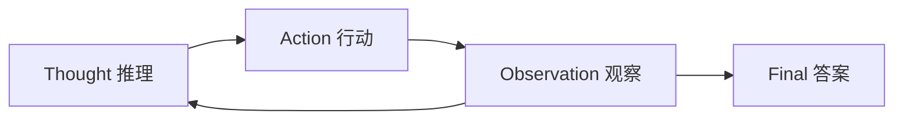
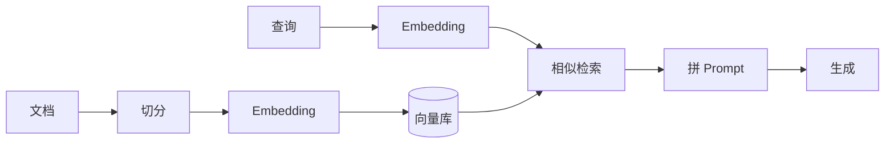
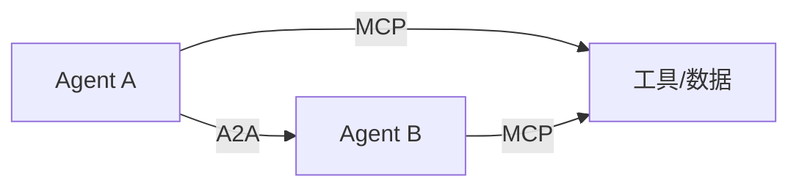

# 🤖 AI / Agent 方向面试题

> 若岗位涉及大模型应用 / Agent 工程 / AI 平台，这些是高频考点。
> 每题给答案 + 追问，兼顾原理与工程。

---

## 目录

- [Part 1 大模型基础](#part-1-大模型基础)
- [Part 2 Agent 原理](#part-2-agent-原理)
- [Part 3 RAG](#part-3-rag)
- [Part 4 MCP / A2A / Function Calling](#part-4-mcp--a2a--function-calling)
- [Part 5 Agent 工程化](#part-5-agent-工程化)
- [Part 6 成本与性能](#part-6-成本与性能)

---

## Part 1 大模型基础

### Q1.1 Transformer 的核心是什么？
**参考答案：** 核心是**自注意力机制（Self-Attention）**：每个 token 通过 Q/K/V 计算与其它 token 的相关性权重，
加权聚合上下文信息，从而建模长距离依赖。配合**多头注意力**（多子空间并行）、**位置编码**、**前馈网络 + 残差 + LayerNorm**。
**追问：注意力复杂度？** O(n²)，n 为序列长度，故长上下文成本高——这也是上下文压缩的动机。

### Q1.2 什么是 Token？影响什么？
**参考答案：** 模型处理文本的最小单元（可为词/子词/字符）。影响**成本（按 token 计费）、上下文长度、推理速度**。

### Q1.3 温度（Temperature）/ Top-p 是什么？
**参考答案：** 采样参数。温度越低输出越确定，越高越随机；Top-p（核采样）从累积概率前 p 的词中采样。
工程上：**需要稳定的结构化输出用低温度**，创意生成用高温度。

### Q1.4 什么是幻觉（Hallucination）？怎么缓解？
**参考答案：** 模型生成看似合理但错误的内容。缓解：RAG 提供事实依据、降低温度、
约束输出格式、引入**校验环节（如本项目 Jev 校验/评分）**、多模型交叉验证。

### Q1.5 什么是指令微调 / RLHF？
**参考答案：** SFT（监督微调）用标注数据对齐格式；RLHF（人类反馈强化学习）用奖励模型 + PPO 对齐人类偏好。
**追问：DPO？** 直接偏好优化，免去奖励模型，训练更简单。

---

## Part 2 Agent 原理

### Q2.1 什么是 Agent？和普通 LLM 调用有什么区别？
**参考答案：** Agent = **LLM + 规划 + 记忆 + 工具使用 + 反馈循环**。
普通调用是一次「输入→输出」；Agent 能**自主多步**：思考→行动（调工具）→观察→再思考，直到完成任务。

### Q2.2 讲讲 ReAct 范式。
**参考答案：** Reasoning + Acting 交替：模型先输出**推理**（Thought），再输出**行动**（Action，如调工具），
环境返回**观察**（Observation），循环直至给出最终答案（Final Answer）。优点：可解释、可纠错。

### Q2.3 单 Agent 和多 Agent 怎么选？
**参考答案：**
- **单 Agent**：链路简单、可控、token 省，适合大多数任务；
- **多 Agent**：当任务需要**不同专长/工具集**且单 Agent 上下文无法承载时才用；
- **风险**：多 Agent 的收益常来自算力堆叠，盲目使用会 token 爆炸 + 协调困难。
- **务实策略**：单 Agent 为主，多 Agent 弹性补充（本项目做法）。

### Q2.4 Agent 的记忆分几层？
**参考答案：**
| 层 | 作用 | 类比 |
|---|---|---|
| Working（工作记忆） | 当前会话上下文 | 短期记忆 |
| Episodic（情景记忆） | 历史交互事件 | 经历 |
| Semantic（语义记忆） | 抽取出的事实/知识 | 长期知识 |
常见实现：Redis 存 working/episodic，向量库存 semantic。

### Q2.5 Agent 如何规划任务？
**参考答案：** 常见范式：CoT（思维链）、ReAct、Plan-and-Execute（先规划再执行）、
Reflexion（失败反思重试）、ToT（思维树，多路径搜索）。

---

## Part 3 RAG

### Q3.1 什么是 RAG？流程是什么？
**参考答案：** Retrieval-Augmented Generation，检索增强生成。流程：
**文档切分 → 向量化 → 存入向量库 → 查询向量化 → 相似检索 → 拼接进 Prompt → LLM 生成**。
价值：给模型注入**外部/私有知识**，缓解幻觉与知识过时。

### Q3.2 切分（Chunking）有哪些策略？
**参考答案：** 固定长度、按语义（段落/标题）、递归切分、重叠窗口（防止跨块语义断裂）。
权衡块大小：太大检索不精准，太小上下文不完整。

### Q3.3 向量检索原理？
**参考答案：** 用 Embedding 模型把文本映射为高维向量，**语义相近的向量距离近**（余弦相似度）。
常用近似最近邻（ANN）索引加速：HNSW、IVF、PQ。

### Q3.4 怎么提升 RAG 质量？
**参考答案：**
1. **混合检索**：向量 + 关键词（BM25）互补；
2. **重排序（Rerank）**：召回后用小模型精排；
3. **Query 改写**：多路查询、HyDE；
4. **切分优化 + 元数据过滤**；
5. **引用溯源**：答案标注来源。

---

## Part 4 MCP / A2A / Function Calling

### Q4.1 什么是 Function Calling？
**参考答案：** 让 LLM 输出结构化的工具调用请求（函数名 + 参数 JSON），由宿主执行后把结果回传。
是 Agent 使用工具的基础机制。

### Q4.2 什么是 MCP？
**参考答案：** Model Context Protocol，**标准化模型与外部工具/数据源的连接协议**。
统一了「工具注册、发现、调用」的接口，避免每个模型/框架各写一套适配。
本项目 `jev-mcp-gateway` 即 MCP 工具网关，含租户权限边界。

**追问：MCP 的价值？** 一次实现，多处复用；工具生态标准化；权限/审计可集中在网关层做。

### Q4.3 什么是 A2A？
**参考答案：** Agent2Agent，**Agent 之间的互通协议**：通过 Agent Card 描述能力，
支持跨 Agent 发现与委派。与 MCP（Agent↔工具）互补：MCP 连工具，A2A 连 Agent。

### Q4.4 工具调用如何保证安全？
**参考答案：** ① 工具白名单 + 租户权限；② 参数校验/沙箱；③ 敏感操作人工确认；
④ 调用审计；⑤ 护栏拦截恶意指令。

---

## Part 5 Agent 工程化

### Q5.1 如何评价一个 Agent 的好坏？
**参考答案：**
- **任务成功率**；**答案质量**（可用 LLM-as-judge 或人工）；
- **成本**（token/调用次数）；**延迟**；**稳定性**（不崩溃/不越权）。
本项目用 **Jev-as-judge 评测门禁**在黄金数据集上自动回归。

### Q5.2 什么是 LLM-as-a-Judge？有什么坑？
**参考答案：** 用 LLM 给输出打分替代人工评测。坑：位置偏差（偏爱前者）、长度偏差（偏爱长答案）、
自我偏好（偏爱同源模型）；缓解：交换顺序、加评分标准、人工抽检校准。

### Q5.3 如何做 Prompt 工程？
**参考答案：** 明确角色/任务/约束/格式；给示例（Few-shot）；分步思考（CoT）；
结构化输出（JSON schema）；把**系统指令与用户输入严格分区**（防注入）。

### Q5.4 Agent 的可观测怎么做？
**参考答案：** 记录每步的**决策轨迹**（thought/action/observation）、token 与成本、延迟；
指标接入 Prometheus，链路接入 OpenTelemetry / Langfuse。

### Q5.5 如何控制 Agent 的「失控」（无限循环/乱调工具）？
**参考答案：** ① **最大步数上限**（本项目 MAX_STEPS）；② 预算熔断；
③ 工具权限白名单；④ 校验环节判断是否完成；⑤ 超时与熔断。

---

## Part 6 成本与性能

### Q6.1 如何降低 Agent 的 token 成本？
**参考答案：** ① **难度路由**（简单任务用小模型）；② **上下文压缩**（只留相关历史）；
③ **语义缓存**（相同问题复用）；④ 工具结果精简；⑤ 决策下沉（用便宜的小模型做判断）。

### Q6.2 决策模型（如 Jev）和 LLM 的分工？
**参考答案：** 决策模型负责**高频低价值判断**（分类/打分/是否完成），输出类型化原语，
快且便宜、输出稳定；LLM 负责**低频高价值生成**。二者分工，各司其职。

### Q6.3 如何降低延迟？
**参考答案：** ① 流式输出（首 token 快）；② 并行工具调用；
③ 决策下沉减少大模型调用轮次；④ 缓存；⑤ 就近部署。

### Q6.4 大模型推理为什么要用 GPU？显存瓶颈在哪？
**参考答案：** 矩阵运算适合 GPU 并行。推理显存主要被**模型权重 + KV Cache**占用；
长上下文 KV Cache 增长快，故有 PagedAttention（vLLM）等优化。

---

<a href="README.md">← 返回备考中心</a>

