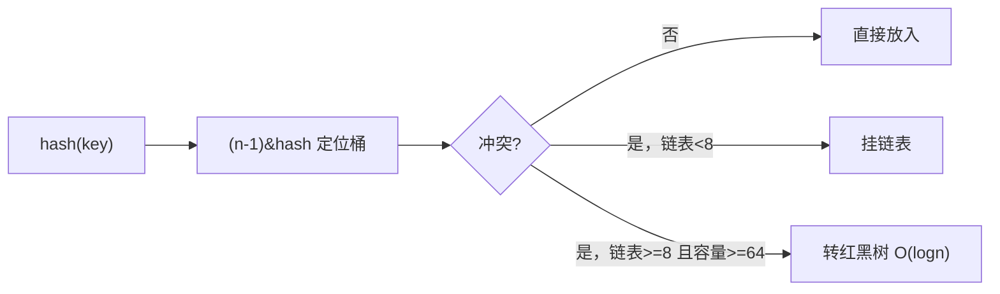
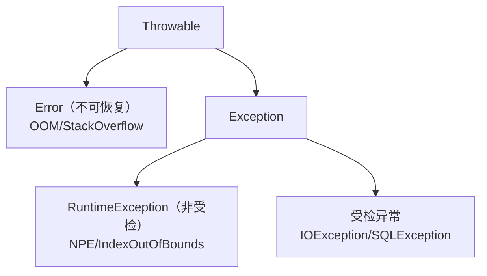

# ☕ Java 基础八股

> 高频考点，题题带答案 + 追问。涵盖集合、泛型、异常、String、新特性。

---

## 目录

- [Part 1 集合框架](#part-1-集合框架)
- [Part 2 泛型与反射](#part-2-泛型与反射)
- [Part 3 String](#part-3-string)
- [Part 4 异常](#part-4-异常)
- [Part 5 == 与 equals](#part-5--与-equals)
- [Part 6 Java 新特性](#part-6-java-新特性)

---

## Part 1 集合框架

### Q1.1 ArrayList 和 LinkedList 的区别？
**参考答案：**
| 维度 | ArrayList | LinkedList |
|---|---|---|
| 底层 | 动态数组 | 双向链表 |
| 随机访问 | O(1) | O(n) |
| 头尾插入删除 | 尾 O(1)均摊 / 头 O(n) | O(1) |
| 内存 | 连续、有扩容拷贝 | 节点有额外指针开销 |
| 适用 | 读多写少 | 频繁头尾增删 |
**追问：ArrayList 扩容？** 默认 10，扩容为原来的 1.5 倍（`oldCap + (oldCap >> 1)`），用 `Arrays.copyOf` 拷贝。

### Q1.2 HashMap 的底层原理？
**参考答案：**
JDK8：**数组 + 链表 + 红黑树**。
- `put`：计算 `hash(key)` → `(n-1) & hash` 定位桶；
- 哈希冲突用链表；**链表长度 ≥ 8 且数组长度 ≥ 64** 时转红黑树；**≤ 6** 退化为链表；
- 负载因子 0.75，超过阈值（容量 × 0.75）触发**扩容为 2 倍**。

**追问：为什么容量是 2 的幂？** 使 `(n-1) & hash` 等价于 `hash % n` 且更高效，保证分布均匀。
**追问：为什么阈值 8？** 泊松分布下链表长度达 8 的概率约千万分之六，避免频繁树化。
**追问：为什么负载因子 0.75？** 空间与冲突概率的折中。

### Q1.3 JDK7 与 JDK8 HashMap 的区别？
**参考答案：** JDK7 是「数组+链表」头插法（多线程扩容可能成环死循环）；
JDK8 改「数组+链表+红黑树」尾插法，且引入红黑树避免哈希碰撞退化。

### Q1.4 HashMap 线程安全吗？怎么解决？
**参考答案：** 不安全（并发 put 可能丢数据/覆盖）。替代：
- `Collections.synchronizedMap`（全表锁，性能差）；
- **`ConcurrentHashMap`**（推荐，CAS + synchronized 桶级锁）。

### Q1.5 ConcurrentHashMap 怎么保证线程安全？
**参考答案：**
- JDK7：**分段锁（Segment）**，锁粒度到段；
- JDK8：**CAS + synchronized 只锁桶头节点**，粒度更细，并发度更高；
- 读操作无锁（`volatile` 保证可见性）；
- 扩容时支持多线程协助迁移。

**追问：为什么 get 不需要加锁？** Node 的 val 与 next 用 volatile 修饰，保证可见性。

### Q1.6 HashMap 与 Hashtable 区别？
**参考答案：** Hashtable 全表 `synchronized`，性能差、不允许 null 键值；HashMap 允许一个 null 键、多个 null 值、非线程安全。

### Q1.7 HashSet 原理？
**参考答案：** 底层是 `HashMap`，元素作为 key，value 是固定 `PRESENT` 对象；去重依赖 `hashCode` + `equals`。

### Q1.8 TreeMap 原理？
**参考答案：** 底层**红黑树**，按 key 排序（自然序或 Comparator），操作 O(log n)。适用需要有序/范围查询。

---

## Part 2 泛型与反射

### Q2.1 什么是类型擦除？有什么影响？
**参考答案：** Java 泛型是**编译期**特性，编译后擦除为原始类型（如 `List<String>` → `List`）。
影响：运行时无法获取泛型参数类型（如 `new T()` 不行）、泛型不能用于 `instanceof`、不能重载仅泛型不同的方法。

### Q2.2 什么是反射？如何应用？
**参考答案：** 运行时获取类信息并操作（`Class`/`Field`/`Method`/`Constructor`）。
应用：Spring 的依赖注入、MyBatis 映射、JDK 动态代理、注解处理。
**缺点**：性能开销、破坏封装、绕过编译期检查。

### Q2.3 什么是动态代理？JDK 与 CGLIB 区别？
**参考答案：**
| 维度 | JDK 动态代理 | CGLIB |
|---|---|---|
| 原理 | 基于接口，`Proxy + InvocationHandler` | 基于继承，字节码生成子类 |
| 要求 | 目标必须实现接口 | 不能代理 final 类/方法 |
| 性能 | JDK8+ 已接近 | 创建慢，调用快 |
Spring AOP：有接口用 JDK，无接口用 CGLIB（Boot 默认全用 CGLIB）。

---

## Part 3 String

### Q3.1 String 为什么不可变？
**参考答案：** `final class` + `private final char[]`（JDK9 起 `byte[]` + coder）。
好处：**线程安全、可缓存 hash、字符串常量池复用、安全（作为参数不被篡改）**。

### Q3.2 String / StringBuilder / StringBuffer？
**参考答案：**
- `String`：不可变；
- `StringBuilder`：可变、**非线程安全**、性能高（推荐单线程拼接）；
- `StringBuffer`：可变、**方法 synchronized**、线程安全、略慢。

### Q3.3 字符串常量池？
**参考答案：** JVM 维护的常量池（JDK7 起移到堆中），相同字面量复用同一对象。
`new String("a")` 会创建（或复用）常量池对象 + 堆对象（共 1~2 个）；`intern()` 可入池。

---

## Part 4 异常

### Q4.1 异常体系？
**参考答案：**

### Q4.2 受检 vs 非受检异常？
**参考答案：** 受检异常（Exception 非 RuntimeException 子类）**必须处理或声明抛出**，编译器强制；
非受检异常（RuntimeException）运行时抛出，不强制处理。

### Q4.3 try-catch-finally 中 finally 会执行吗？
**参考答案：** 会（除 `System.exit`、JVM 崩溃等）。
**陷阱**：finally 中 `return` 会覆盖 try 中的 return；建议 finally 只做资源释放。

### Q4.4 try-with-resources？
**参考答案：** 自动关闭实现了 `AutoCloseable` 的资源，避免手动 finally 关闭的繁琐与遗漏。

---

## Part 5 == 与 equals

### Q5.1 == 和 equals 的区别？
**参考答案：**
- `==`：基本类型比值，引用类型比**地址**；
- `equals`：Object 默认比地址，重写后比**内容**（如 String）。
**规则**：重写 equals 必须重写 hashCode，否则在 HashMap/HashSet 中出错。

### Q5.2 为什么重写 equals 必须重写 hashCode？
**参考答案：** 哈希集合先按 hashCode 定位桶，再用 equals 判等。
若两对象 equals 相等但 hashCode 不同，会被分到不同桶，**导致去重/查找失效**。

### Q5.3 为什么会有 Integer 缓存？
**参考答案：** `Integer` 缓存 **-128~127**，`Integer.valueOf` 在该范围返回缓存对象，故 `==` 可能为 true，超出范围则为 false。**比较包装类一律用 equals**。

---

## Part 6 Java 新特性

### Q6.1 Java 8 有哪些重要特性？
**参考答案：** Lambda、Stream、函数式接口、默认方法、Optional、新的日期时间 API（LocalDateTime）、方法引用。

### Q6.2 Lambda 和函数式接口？
**参考答案：** 函数式接口只有**一个抽象方法**（可 `@FunctionalInterface`），Lambda 是其简写。
常用：`Function`、`Consumer`、`Supplier`、`Predicate`。

### Q6.3 Stream 的惰性求值？
**参考答案：** Stream 的中间操作（map/filter）**惰性**，只有遇到终止操作（collect/forEach）才执行；
数据源只遍历一次，流不可复用。

### Q6.4 Java 21 的重要特性？
**参考答案：**
- **虚拟线程（Virtual Threads）**：轻量级线程，高并发 IO；
- **记录类（Record）**：不可变数据载体；
- **模式匹配**（switch/instanceof）；
- **密封类（Sealed）**；
- 分代 ZGC。
> 本项目大量使用虚拟线程与 Record，是很好的加分谈资。

### Q6.5 虚拟线程与平台线程的区别？
**参考答案：** 平台线程 1:1 映射 OS 线程，创建成本高；
虚拟线程由 JVM 调度、M:N 映射到少量载体线程（carrier），阻塞时自动让出载体，
**极低成本支撑海量并发**，尤其适合 IO 密集（正契合 Agent 场景）。

---

<a href="README.md">← 返回备考中心</a>

