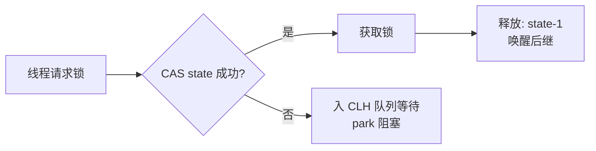
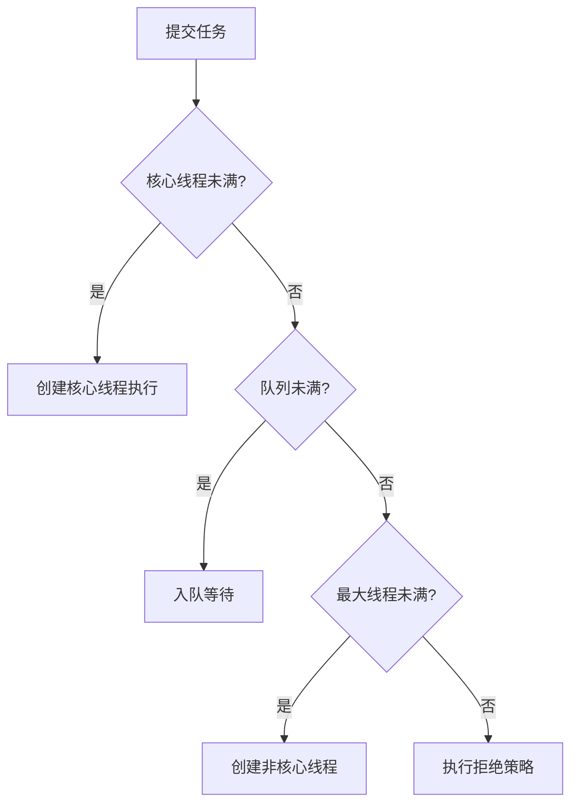

# 🧵 并发编程八股

> 中大厂必考重灾区。涵盖 JMM、锁、AQS、线程池、CAS、并发容器。

---

## 目录

- [Part 1 内存模型](#part-1-内存模型)
- [Part 2 synchronized](#part-2-synchronized)
- [Part 3 volatile 与 CAS](#part-3-volatile-与-cas)
- [Part 4 AQS 与 Lock](#part-4-aqs-与-lock)
- [Part 5 线程池](#part-5-线程池)
- [Part 6 并发容器与工具类](#part-6-并发容器与工具类)

---

## Part 1 内存模型

### Q1.1 讲讲 JMM（Java 内存模型）。
**参考答案：** JMM 定义多线程下**共享变量的可见性、有序性、原子性**规则。
- 每个线程有自己的**工作内存**（含共享变量副本），操作共享变量需从主内存读/写；
- 三大特性：**原子性、可见性、有序性**；
- 通过 `volatile`、`synchronized`、`final`、Happens-Before 规则来保证。

**追问：Happens-Before？** 若 A happens-before B，则 A 的执行结果对 B 可见。如程序顺序、锁、volatile、线程启动/终止规则。

### Q1.2 为什么会有可见性问题？
**参考答案：** 线程把变量缓存在工作内存/CPU 缓存，修改未及时刷回主内存，
其他线程读到旧值。`volatile`/`synchronized` 可强制刷新。

### Q1.3 指令重排序？
**参考答案：** 编译器/CPU 为优化性能会调整指令顺序，单线程语义不变，但多线程可能出错。
`volatile` 通过**内存屏障**禁止特定重排。经典案例：双重检查锁（DCL）单例需 `volatile`。

---

## Part 2 synchronized

### Q2.1 synchronized 的原理？
**参考答案：** 修饰方法/代码块，通过**对象监视器（Monitor）**实现互斥。
- 代码块：编译为 `monitorenter`/`monitorexit`；
- 方法：ACC_SYNCHRONIZED 标志。
保证**原子性 + 可见性 + 有序性**。

### Q2.2 锁升级过程？
**参考答案：**

- **偏向锁**：同一线程反复进入，仅记录线程 ID（JDK15 后已废弃）；
- **轻量级锁**：多线程轻度竞争，CAS 自旋；
- **重量级锁**：竞争激烈，自旋失败后挂起线程。

**追问：锁存在哪？** 对象头的 Mark Word。

### Q2.3 synchronized 和 Lock 的区别？
**参考答案：**
| 维度 | synchronized | ReentrantLock |
|---|---|---|
| 层面 | JVM 关键字 | JDK 类（AQS） |
| 释放 | 自动 | 手动 `unlock`（finally） |
| 可中断 | 否 | `lockInterruptibly` |
| 超时/尝试 | 否 | `tryLock(timeout)` |
| 公平锁 | 否 | 可选 |
| 条件变量 | 单条件 | 多 `Condition` |

---

## Part 3 volatile 与 CAS

### Q3.1 volatile 的作用？
**参考答案：**
1. **可见性**：写立即刷主存，读从主存读；
2. **有序性**：禁止指令重排（内存屏障）；
3. **不保证原子性**（如 `i++` 仍需同步）。

### Q3.2 什么是 CAS？有什么问题？
**参考答案：** Compare And Swap，比较并交换，由 CPU 原子指令实现。
**问题**：
- **ABA 问题** → 用版本号 `AtomicStampedReference`；
- **自旋开销**（长时间不成功 CPU 空转）；
- 只能保证**一个变量**的原子性。

### Q3.3 原子类的原理？
**参考答案：** 基于 CAS + volatile（如 `AtomicInteger` 用 `Unsafe.compareAndSwapInt`）。
高并发下 `LongAdder` 用**分段累加**（Cell 数组）比 `AtomicLong` 性能更好。

---

## Part 4 AQS 与 Lock

### Q4.1 什么是 AQS？
**参考答案：** AbstractQueuedSynchronizer，抽象队列同步器。核心：
- 一个 **volatile int state**（同步状态）；
- 一个 **CLH 双向队列**（等待线程）；
- 模板方法 `tryAcquire/tryRelease` 由子类实现。

`ReentrantLock`、`Semaphore`、`CountDownLatch`、`ReentrantReadWriteLock` 都基于 AQS。

### Q4.2 ReentrantLock 如何实现可重入？
**参考答案：** state 记录重入次数，同一线程再次获取时 state+1，释放时 -1，为 0 才真正释放。

### Q4.3 公平锁与非公平锁？
**参考答案：** 公平锁按队列顺序获取（`hasQueuedPredecessors` 判断）；
非公平锁允许插队（可能饿死但吞吐更高，默认非公平）。

### Q4.4 ReentrantReadWriteLock？
**参考答案：** 读写分离，读读不互斥、读写/写写互斥，适合**读多写少**。state 高 16 位记读锁、低 16 位记写锁。

---

## Part 5 线程池

### Q5.1 线程池的核心参数？
**参考答案：**

七大参数：**corePoolSize、maximumPoolSize、keepAliveTime、unit、workQueue、threadFactory、handler**。

### Q5.2 四种拒绝策略？
**参考答案：**
- `AbortPolicy`：抛异常（默认）；
- `CallerRunsPolicy`：调用者线程执行（降速）；
- `DiscardPolicy`：静默丢弃；
- `DiscardOldestPolicy`：丢最老的。

### Q5.3 线程池大小如何设置？
**参考答案：**
- **CPU 密集**：`N+1`（N 为核数）；
- **IO 密集**：`2N` 或更高，或按 `核数 × (1 + 等待时间/计算时间)`；
- 实际应**压测调优**。也可用虚拟线程（本项目做法）绕开池大小问题。

### Q5.4 线程池为什么用阻塞队列？常见队列？
**参考答案：** 缓冲任务、削峰。常见：`ArrayBlockingQueue`（有界）、`LinkedBlockingQueue`（可有界/无界）、`SynchronousQueue`（不存储）、`PriorityBlockingQueue`。

### Q5.5 execute 和 submit 的区别？
**参考答案：** `execute` 无返回值、异常直接抛出；
`submit` 返回 `Future`，异常被封装，调用 `get()` 时抛出。

### Q5.6 线程池状态？
**参考答案：** RUNNING、SHUTDOWN（不接受新任务、处理完队列）、STOP（中断任务）、TIDYING、TERMINATED。

---

## Part 6 并发容器与工具类

### Q6.1 CountDownLatch / CyclicBarrier / Semaphore？
**参考答案：**
| 工具 | 作用 | 特点 |
|---|---|---|
| CountDownLatch | 等待 N 个任务完成 | 一次性，不可重置 |
| CyclicBarrier | N 个线程互相等待到齐 | 可循环使用 |
| Semaphore | 控制并发访问数（限流） | 许可证机制 |

### Q6.2 ThreadLocal 原理与内存泄漏？
**参考答案：** 每个 Thread 有 `ThreadLocalMap`，key 是 ThreadLocal 的**弱引用**，value 是强引用。
**泄漏原因**：线程池中线程长期存活，key 被回收后 value 无法访问却不释放。
**解决**：使用后 `remove()`。
**追问：为什么 key 用弱引用？** 至少让 key 可回收，减少泄漏。

### Q6.3 阻塞队列的阻塞原理？
**参考答案：** 基于 `ReentrantLock` + `Condition`：队列空时消费者 `await`，入队后 `signal`；队列满时生产者 `await`。

### Q6.4 CopyOnWriteArrayList？
**参考答案：** 写时复制：写操作加锁并复制新数组，读操作无锁读旧数组。
适合**读多写少**；写代价大。

> 💡 本项目 `InMemoryMemoryStore` 用 `CopyOnWriteArrayList` 替代「ArrayList 复制」，
> 提升并发读性能——是很好的实战谈资。

---

<a href="README.md">← 返回备考中心</a>

