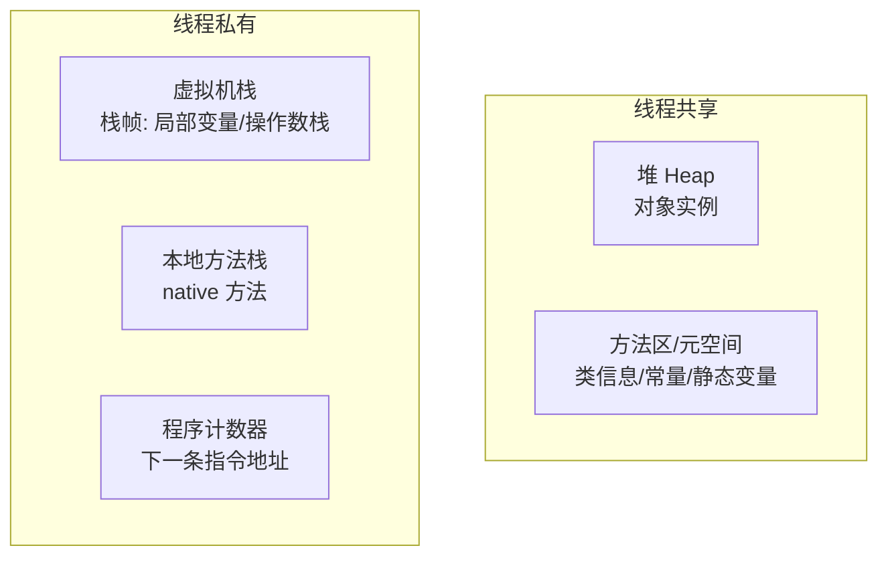
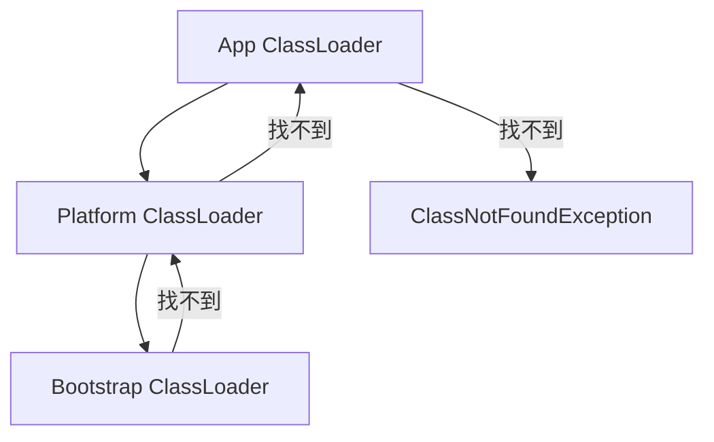

# ⚙️ JVM 八股

> 内存结构、对象、GC、类加载、调优。中大厂高频。

---

## 目录

- [Part 1 内存结构](#part-1-内存结构)
- [Part 2 对象](#part-2-对象)
- [Part 3 垃圾回收](#part-3-垃圾回收)
- [Part 4 类加载](#part-4-类加载)
- [Part 5 调优与工具](#part-5-调优与工具)
- [Part 6 JIT 与执行引擎](#part-6-jit-与执行引擎)

---

## Part 1 内存结构

### Q1.1 JVM 运行时内存区域？
**参考答案：**



### Q1.2 堆的分区？
**参考答案：** 新生代（Eden + 两个 Survivor S0/S1，默认 8:1:1）+ 老年代，比例默认 1:2。
新对象多分配在 Eden，Minor GC 后存活对象在 Survivor 间复制，达到年龄阈值（默认 15）晋升老年代。

### Q1.3 方法区 / 元空间？
**参考答案：** JDK8 起用**元空间（Metaspace）**替代永久代，位于**本地内存**而非堆，
避免永久代 OOM，大小受本机内存限制。

### Q1.4 栈帧结构？
**参考答案：** 局部变量表、操作数栈、动态链接、方法返回地址。

---

## Part 2 对象

### Q2.1 对象创建过程？
**参考答案：** 类加载检查 → 分配内存（指针碰撞/空闲列表）→ 初始化零值 →
设置对象头（Mark Word + 类型指针）→ 执行构造方法。

### Q2.2 对象内存布局？
**参考答案：** 对象头（Mark Word 哈希/GC 年龄/锁状态 + 类型指针） + 实例数据 + 对齐填充。

### Q2.3 对象引用类型？
**参考答案：** 强引用（不回收）、软引用（内存不足回收）、弱引用（GC 即回收）、虚引用（回收通知）。

### Q2.4 如何判断对象可回收？
**参考答案：** **可达性分析**：从 GC Roots（栈中引用、静态变量、常量、JNI 引用）出发，
不可达的对象可回收（经历两次标记）。不用引用计数（无法解决循环引用）。

---

## Part 3 垃圾回收

### Q3.1 GC 算法？
**参考答案：**
- **标记-清除**：有内存碎片；
- **标记-复制**：无碎片但浪费空间（用于新生代）；
- **标记-整理**：无碎片，移动对象（用于老年代）。

### Q3.2 分代收集理论？
**参考答案：** 对象越老越难死：新生代用复制算法（Minor GC 频繁但快），
老年代用标记-整理/清除（Major/Full GC 慢）。

### Q3.3 常见垃圾收集器？
**参考答案：**
| 收集器 | 区域 | 特点 |
|---|---|---|
| Serial | 新生代 | 单线程，适合小内存 |
| ParNew | 新生代 | 多线程版 Serial |
| Parallel Scavenge | 新生代 | 吞吐量优先 |
| CMS | 老年代 | 并发、低停顿，有碎片（已废弃） |
| G1 | 整堆 | 分 Region、可预测停顿，JDK9 默认 |
| ZGC | 整堆 | 超低停顿（亚毫秒），染色指针 |
| Shenandoah | 整堆 | 低延迟，与 G1 竞争 |

**追问：G1 与 CMS 区别？** G1 整堆管理、Region 划分、可设定目标停顿、无碎片整理问题。

### Q3.4 什么时候触发 Full GC？
**参考答案：** 老年代空间不足、元空间不足、显式 `System.gc()`、CMS 并发失败等。应尽量避免（停顿长）。

### Q3.5 GC Roots 有哪些？
**参考答案：** 虚拟机栈局部变量引用的对象、方法区静态属性/常量引用的对象、本地方法栈 JNI 引用、活跃线程、系统类加载器等。

---

## Part 4 类加载

### Q4.1 类加载过程？
**参考答案：** 加载 → 验证 → 准备 → 解析 → 初始化（+ 使用、卸载）。
- 准备：为静态变量分配内存并赋默认值；
- 初始化：执行 `<clinit>`（静态变量赋值 + 静态代码块）。

### Q4.2 类加载器？双亲委派？
**参考答案：** 启动类加载器 → 扩展/平台类加载器 → 应用类加载器 → 自定义。
**双亲委派**：收到加载请求先委托父加载器，父无法完成才自己加载。



**作用**：保证核心类安全（如自定义 `java.lang.String` 不会被加载）、避免重复加载。

### Q4.3 如何打破双亲委派？
**参考答案：** 重写 `loadClass`（如 Tomcat 的 WebAppClassLoader 优先本地加载）、
SPI 用线程上下文类加载器（如 JDBC DriverManager）。

### Q4.4 为什么需要自定义类加载器？
**参考答案：** 隔离（不同版本 Jar）、热部署、加密类、从非标准源加载。

---

## Part 5 调优与工具

### Q5.1 常见 JVM 参数？
**参考答案：**
```
-Xms2g -Xmx2g          # 堆初始/最大（建议相等避免抖动）
-Xmn1g                 # 新生代
-XX:MetaspaceSize=256m
-XX:+UseG1GC           # 或用 ZGC
-XX:MaxGCPauseMillis=200
-XX:+HeapDumpOnOutOfMemoryError -XX:HeapDumpPath=/dumps
```

### Q5.2 排查 OOM 的思路？
**参考答案：**
1. 看日志确认 OOM 类型（Heap/GC overhead/Metaspace/Direct buffer）；
2. `jmap -dump` / `HeapDumpOnOutOfMemoryError` 导出堆；
3. 用 **MAT / JProfiler** 分析支配树/泄漏嫌疑；
4. 定位大对象/泄漏点，修复。

### Q5.3 CPU 飙高怎么排查？
**参考答案：** `top -Hp <pid>` 找高 CPU 线程 → `printf '%x'` 转十六进制 →
`jstack <pid> | grep -A 20 <nid>` 定位线程栈 → 分析死循环/频繁 GC。

### Q5.4 常用 JVM 工具？
**参考答案：** jps、jstat（GC 统计）、jmap（堆）、jstack（线程栈）、jinfo、VisualVM、Arthas。

### Q5.5 内存泄漏与内存溢出区别？
**参考答案：** 泄漏：对象该回收却无法回收，逐渐耗尽内存；
溢出（OOM）：内存确实不够。泄漏是溢出的常见原因之一。

---

## Part 6 JIT 与执行引擎

### Q6.1 解释执行 vs 编译执行？
**参考答案：** JVM 先解释执行字节码（启动快），热点代码由 **JIT 编译为机器码**（运行快）。
C1（Client，快速编译）、C2（Server，深度优化），**分层编译**兼顾启动与峰值。

### Q6.2 什么是逃逸分析？
**参考答案：** 判断对象是否逃逸出方法/线程范围。若不逃逸，可**栈上分配、标量替换、锁消除**，减少堆压力。

### Q6.3 什么是即时编译的优化手段？
**参考答案：** 方法内联、逃逸分析、循环展开、公共子表达式消除、死代码消除。

### Q6.4 常量池有几种？
**参考答案：** Class 文件常量池、运行时常量池（方法区）、字符串常量池（堆）、基本类型包装缓存。

---

<p align="right"><a href="README.md">← 返回备考中心</a></p>
