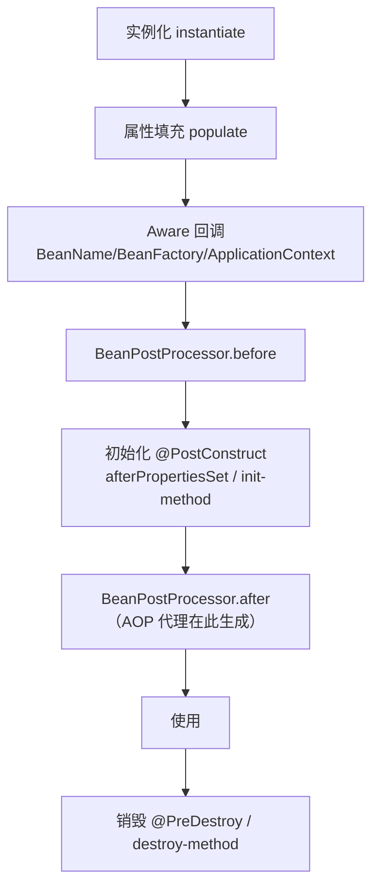
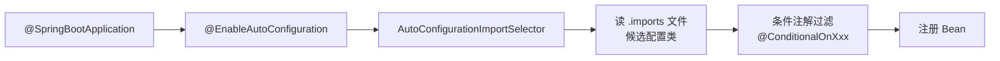

# 🌱 Spring / Spring Boot 八股

> IoC、AOP、事务、循环依赖、自动配置。后端必考。

---

## 目录

- [Part 1 IoC 与 DI](#part-1-ioc-与-di)
- [Part 2 Bean 生命周期](#part-2-bean-生命周期)
- [Part 3 循环依赖](#part-3-循环依赖)
- [Part 4 AOP](#part-4-aop)
- [Part 5 事务](#part-5-事务)
- [Part 6 Spring Boot](#part-6-spring-boot)

---

## Part 1 IoC 与 DI

### Q1.1 什么是 IoC 和 DI？
**参考答案：** IoC（控制反转）是把对象的创建与依赖管理交给容器，而不是代码里 `new`；
DI（依赖注入）是 IoC 的实现方式，容器把依赖注入到对象中。
好处：**解耦、易测试、易替换实现**。

### Q1.2 依赖注入的方式？
**参考答案：**
- **构造器注入**（推荐，依赖不可变、便于测试、能暴露循环依赖）；
- Setter 注入；
- 字段注入（`@Autowired` 直接标字段，简洁但不推荐，难测试且隐藏依赖）。

> 💡 本项目决策组件有多个构造器时，用 `@Autowired` 标注主构造器消除 Spring 歧义（真实踩坑）。

### Q1.3 Bean 的作用域？
**参考答案：** singleton（默认）、prototype、request、session、application、websocket。
**追问：单例 Bean 线程安全吗？** 容器不保证，需自己保证（无状态 Bean 天然安全）。

---

## Part 2 Bean 生命周期

### Q2.1 Bean 的完整生命周期？
**参考答案：**

**追问：AOP 代理在哪一步生成？** `BeanPostProcessor.postProcessAfterInitialization`。

---

## Part 3 循环依赖

### Q3.1 Spring 如何解决循环依赖？
**参考答案：** 用**三级缓存**：
- **一级** `singletonObjects`：成品 Bean；
- **二级** `earlySingletonObjects`：半成品（未填充属性）；
- **三级** `singletonFactories`：Bean 工厂（可生成早期引用/代理）。

**追问：为什么要三级而不是两级？**
三级缓存的工厂是为了在需要时提前生成 **AOP 代理**，保证注入的代理与最终 Bean 一致。

### Q3.2 哪些循环依赖解决不了？
**参考答案：**
- **构造器注入**的循环依赖（实例化阶段就卡死）；
- **prototype** 作用域的循环依赖；
- `@Async` 等需要代理但时机不匹配的场景。
**结论**：最优雅的做法是**从设计上解耦**，避免循环依赖。

---

## Part 4 AOP

### Q4.1 什么是 AOP？应用场景？
**参考答案：** 面向切面编程，把横切关注点（日志、事务、权限、缓存、限流、熔断）从业务中剥离。
核心概念：切面（Aspect）、连接点（JoinPoint）、切点（Pointcut）、通知（Advice）、织入（Weaving）。

### Q4.2 AOP 的实现原理？
**参考答案：** 运行时**动态代理**：目标有接口用 JDK 动态代理，无接口用 CGLIB；
Spring Boot 默认全部用 CGLIB。

### Q4.3 通知类型？
**参考答案：** `@Before`、`@AfterReturning`、`@AfterThrowing`、`@After`、`@Around`（最强，可控制是否执行）。

---

## Part 5 事务

### Q5.1 Spring 事务传播行为？
**参考答案：**
| 传播行为 | 说明 |
|---|---|
| REQUIRED（默认） | 有则加入，无则新建 |
| REQUIRES_NEW | 总是新建，挂起外层 |
| NESTED | 嵌套（保存点） |
| SUPPORTS | 有则用，无则非事务 |
| NOT_SUPPORTED | 非事务执行，挂起外层 |
| MANDATORY | 必须已有事务，否则抛异常 |
| NEVER | 必须无事务，否则抛异常 |

### Q5.2 事务失效场景？（高频）
**参考答案：**
1. **方法非 public**；
2. **自调用**（同类内方法调用不走代理）；
3. 异常被 catch 未抛出；
4. 抛出**受检异常**未配置 `rollbackFor`（默认只回滚 RuntimeException/Error）；
5. 多线程调用（事务是 ThreadLocal）；
6. 数据库引擎不支持事务（如 MyISAM）；
7. 传播行为配置不当。

### Q5.3 事务实现原理？
**参考答案：** AOP 代理 + `TransactionInterceptor`：方法前开启事务（绑定连接、设置自动提交 false），
方法后提交/回滚，连接通过 ThreadLocal 绑定。

### Q5.4 事务隔离级别？
**参考答案：** READ_UNCOMMITTED、READ_COMMITTED（Oracle 默认）、
REPEATABLE_READ（MySQL 默认）、SERIALIZABLE。

---

## Part 6 Spring Boot

### Q6.1 自动配置原理？（高频）
**参考答案：**
1. `@SpringBootApplication` 含 `@EnableAutoConfiguration`；
2. 它通过 `@Import(AutoConfigurationImportSelector)` 读取
   `META-INF/spring/org.springframework.boot.autoconfigure.AutoConfiguration.imports`（Spring Boot 2.7+）/ 旧版 `spring.factories`；
3. 加载候选自动配置类，用 `@ConditionalOnClass/@ConditionalOnMissingBean` 等**条件注解**按需生效。

> 💡 本项目踩坑：库模块的 `@AutoConfiguration` **必须登记在 `.imports` 文件**才会生效（见 BUGFIX #2）。

### Q6.2 常用条件注解？
**参考答案：** `@ConditionalOnClass`（类存在）、`@ConditionalOnMissingBean`（Bean 不存在）、
`@ConditionalOnProperty`（配置项）、`@ConditionalOnWebApplication`。

### Q6.3 Spring Boot 启动流程？
**参考答案：** `SpringApplication.run` → 准备环境 → 创建 ApplicationContext →
刷新上下文（BeanFactory 准备、BeanPostProcessor 注册、Bean 实例化）→ 发布事件 → 启动内嵌容器。

### Q6.4 starter 原理？
**参考答案：** starter = 依赖聚合 + 自动配置。引入 starter 自动带齐依赖，
配合自动配置类实现「约定优于配置」。

### Q6.5 @ConfigurationProperties 与 @Value？
**参考答案：** `@ConfigurationProperties` 支持**类型安全批量绑定**、松散绑定、校验、嵌套（推荐）；
`@Value` 单值注入，功能较弱。本项目大量使用前者。

---

<a href="README.md">← 返回备考中心</a>

