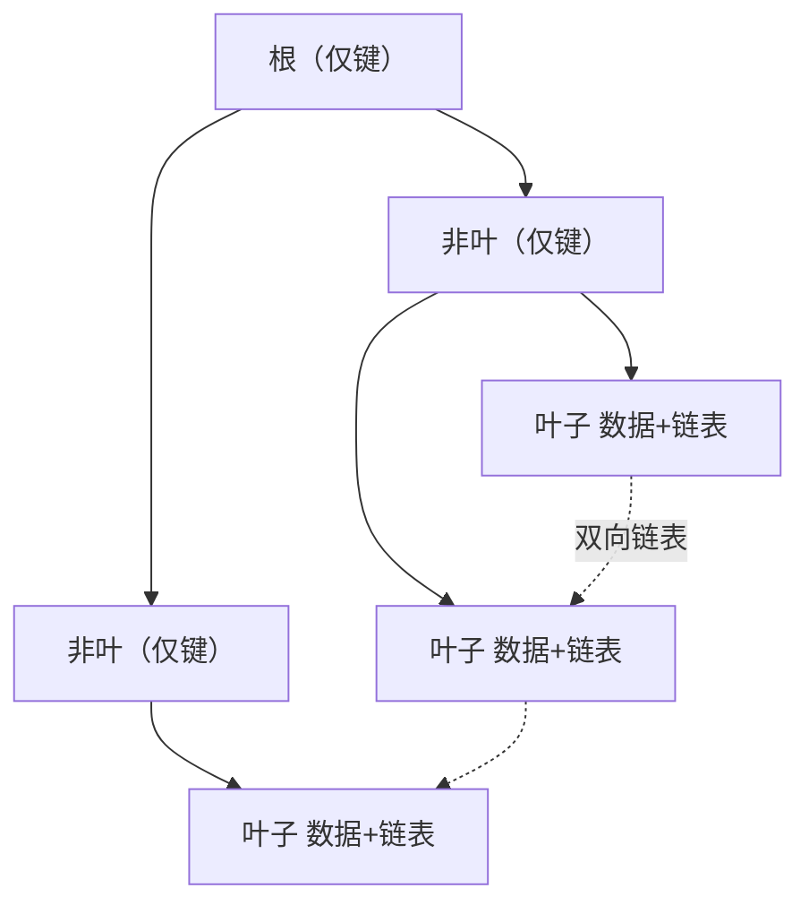

# 🗄 MySQL 八股

> 索引、事务、锁、MVCC、SQL 优化。后端核心考点。

---

## 目录

- [Part 1 索引](#part-1-索引)
- [Part 2 事务与 MVCC](#part-2-事务与-mvcc)
- [Part 3 锁](#part-3-锁)
- [Part 4 SQL 优化](#part-4-sql-优化)
- [Part 5 日志与复制](#part-5-日志与复制)
- [Part 6 架构与高可用](#part-6-架构与高可用)

---

## Part 1 索引

### Q1.1 为什么用 B+ 树做索引？
**参考答案：**
- 相比 B 树：B+ 树**只有叶子节点存数据**，非叶节点只存键，**单节点能放更多键 → 树更矮 → IO 更少**；
- 叶子节点**双向链表连接**，天然支持**范围查询和排序**；
- 相比哈希：支持范围查询、有序遍历；相比红黑树：树高低、磁盘 IO 少。

### Q1.2 聚簇索引与非聚簇索引？
**参考答案：**
- **聚簇索引（主键索引）**：叶子节点存**整行数据**，InnoDB 主键即聚簇索引；
- **非聚簇索引（二级索引）**：叶子存**主键值**，查询非索引列需**回表**。

**追问：什么是回表？** 通过二级索引找到主键，再回聚簇索引取完整行。

### Q1.3 覆盖索引？
**参考答案：** 查询所需字段都在索引中，无需回表，性能高。`explain` 的 `Extra` 显示 `Using index`。

### Q1.4 最左前缀原则？
**参考答案：** 联合索引 `(a,b,c)` 只有在查询条件从最左列开始连续匹配才能用到索引：
`a`、`a+b`、`a+b+c` 可命中；`b`、`b+c` 不能。范围查询后的列无法走索引排序。

### Q1.5 索引失效场景？（高频）
**参考答案：**
1. 对索引列做**函数/运算**（`WHERE YEAR(t)=2026`）；
2. 隐式类型转换（字符串列传数字）；
3. `LIKE '%xx'` 前置通配；
4. `OR` 连接非索引列；
5. 违反最左前缀；
6. `!=`、`NOT IN`、`IS NOT NULL`（视情况）；
7. 优化器认为全表扫描更快（表小/区分度低）。

### Q1.6 什么列适合建索引？
**参考答案：** 频繁查询（WHERE/JOIN/ORDER BY/GROUP BY）、**区分度高**、字段较小的列。
不适合：更新频繁、区分度低（如性别）、大文本。

### Q1.7 索引下推（ICP）？
**参考答案：** MySQL 5.6+ 把 WHERE 中的过滤条件下推到存储引擎层，在索引上先过滤再回表，减少回表次数。

---

## Part 2 事务与 MVCC

### Q2.1 ACID？
**参考答案：** 原子性（Atomicity）、一致性（Consistency）、隔离性（Isolation）、持久性（Durability）。
实现：原子性/持久性靠**redo log**，一致性靠**undo log + 约束**，隔离性靠**锁 + MVCC**。

### Q2.2 隔离级别与并发问题？
**参考答案：**
| 隔离级别 | 脏读 | 不可重复读 | 幻读 |
|---|---|---|---|
| 读未提交 | √ | √ | √ |
| 读已提交 RC | × | √ | √ |
| 可重复读 RR（MySQL 默认） | × | × | InnoDB 基本避免 |
| 串行化 | × | × | × |

### Q2.3 MVCC 原理？（高频）
**参考答案：** 多版本并发控制，实现**读写不阻塞**。核心：
- **隐藏列**：`DB_TRX_ID`（事务 ID）、`DB_ROLL_PTR`（回滚指针）；
- **undo log 版本链**：记录数据的多个历史版本；
- **Read View**：判断哪个版本对当前事务可见（活跃事务列表 + 最小/最大事务 ID）。

**RC vs RR**：RC 每次 SELECT 生成新 Read View；RR 在事务首次 SELECT 生成，后续复用 → 可重复读。

### Q2.4 幻读怎么解决？
**参考答案：** InnoDB 在 RR 下用**间隙锁（Gap Lock）+ Next-Key Lock** 防止其他事务在范围内插入；
或在应用层用 `SELECT ... FOR UPDATE`。

---

## Part 3 锁

### Q3.1 InnoDB 锁类型？
**参考答案：**
- 按粒度：**表锁、行锁**；
- 按模式：**共享锁 S（读锁）、排他锁 X（写锁）**；
- **意向锁**（IS/IX）：表级，表明表中有行锁；
- **记录锁（Record）**：锁具体行；
- **间隙锁（Gap）**：锁区间，防插入；
- **临键锁（Next-Key）**：记录锁 + 间隙锁，RR 默认。

### Q3.2 行锁什么时候升级为表锁？（陷阱题）
**参考答案：** 行锁本身不升级。但**如果查询未走索引**，InnoDB 会锁住**所有行**（表现为类表锁效果）。

### Q3.3 死锁怎么产生？怎么避免？
**参考答案：** 两个事务互相持有对方需要的锁。
避免：① 按**固定顺序**访问资源；② 缩短事务；③ 使用合适索引减少锁范围；
④ 设置 `innodb_lock_wait_timeout`；⑤ 死锁后 MySQL 自动检测回滚代价小的事务。

### Q3.4 乐观锁与悲观锁？
**参考答案：**
- **悲观锁**：`SELECT ... FOR UPDATE`，假设冲突多，先锁；
- **乐观锁**：用版本号/时间戳，提交时校验（`UPDATE ... WHERE version=?`），假设冲突少。

---

## Part 4 SQL 优化

### Q4.1 explain 关注哪些字段？
**参考答案：**
| 字段 | 含义 |
|---|---|
| `type` | 访问类型：system > const > eq_ref > ref > range > index > ALL（ALL 最差） |
| `key` | 实际使用的索引 |
| `rows` | 预估扫描行数 |
| `Extra` | `Using index`（覆盖）、`Using where`、`Using filesort`（需优化）、`Using temporary`（需优化） |

### Q4.2 慢查询怎么排查优化？
**参考答案：**
1. 开慢查询日志 `slow_query_log`，`long_query_time` 设阈值；
2. 用 `mysqldumpslow` / pt-query-digest 分析；
3. `explain` 看执行计划；
4. 优化：加索引、改 SQL（避免 `SELECT *`、减少子查询、分页优化）、
   分库分表、读写分离、加缓存。

### Q4.3 深分页怎么优化？
**参考答案：** `LIMIT 1000000, 20` 会扫描并丢弃大量行。
优化：① **游标/延迟关联**（`WHERE id > last_id LIMIT 20`）；② 覆盖索引 + 子查询先取主键再 join。

### Q4.4 大表 DDL 怎么做？
**参考答案：** 用 `pt-online-schema-change` / `gh-ost` **在线无锁变更**，或低峰期执行；MySQL 8 部分 DDL 支持 online。

---

## Part 5 日志与复制

### Q5.1 redo log / undo log / binlog 区别？
**参考答案：**
| 日志 | 层级 | 作用 |
|---|---|---|
| redo log | InnoDB | **崩溃恢复**，保证持久性（WAL） |
| undo log | InnoDB | **回滚 + MVCC 版本链** |
| binlog | Server | **归档/主从复制**，逻辑日志 |

**追问：为什么 redo 是物理、binlog 是逻辑？** redo 记录页的物理修改，用于恢复；
binlog 记录 SQL/行变更，用于复制与归档。

### Q5.2 两阶段提交？
**参考答案：** 写 redo（prepare）→ 写 binlog → 提交 redo（commit）。
保证 redo 与 binlog 一致，崩溃后按规则决定提交或回滚。

### Q5.3 主从复制原理？
**参考答案：** 主库写 binlog → 从库 IO 线程拉取写入 relay log →
从库 SQL 线程重放 relay log。
**追问：主从延迟怎么办？** 读主库（关键读）、半同步复制、并行复制、监控延迟。

---

## Part 6 架构与高可用

### Q6.1 分库分表方案？
**参考答案：**
- 垂直拆分：按业务/字段拆；
- 水平拆分：按范围/哈希取模/一致性哈希分片；
- 中间件：ShardingSphere、MyCat；
- 问题：分布式事务、跨库 join、全局 ID、扩容。

### Q6.2 全局唯一 ID 方案？
**参考答案：** 数据库自增（单点）、UUID（无序）、**雪花算法 Snowflake**（趋势递增、含时间戳+机器+序列）、号段模式、Redis 自增。

### Q6.3 MySQL 高可用方案？
**参考答案：** 主从 + MHA/Orchestrator 故障切换、MGR（组复制）、PXC、云 RDS 主备。

---

<a href="README.md">← 返回备考中心</a>

