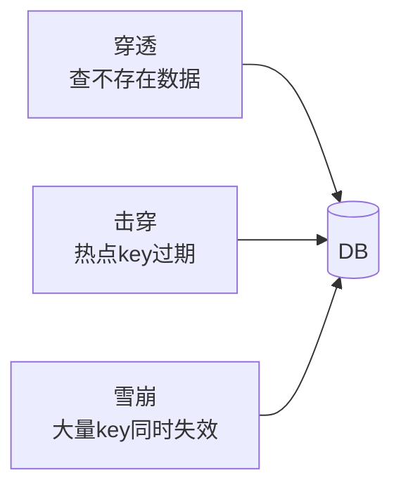

# 🧰 Redis 八股

> 数据结构、持久化、缓存问题、分布式锁、高可用。高频。

---

## 目录

- [Part 1 数据结构与原理](#part-1-数据结构与原理)
- [Part 2 持久化](#part-2-持久化)
- [Part 3 缓存三大问题](#part-3-缓存三大问题)
- [Part 4 分布式锁](#part-4-分布式锁)
- [Part 5 高可用与集群](#part-5-高可用与集群)
- [Part 6 进阶](#part-6-进阶)

---

## Part 1 数据结构与原理

### Q1.1 Redis 有哪些数据结构？底层实现？
**参考答案：**
| 类型 | 底层 |
|---|---|
| String | SDS（简单动态字符串） |
| List | 双向链表 / quicklist（ziplist + 链表） |
| Hash | hashtable / ziplist（元素少时） |
| Set | intset / hashtable |
| ZSet | ziplist / skiplist（跳表）+ 字典 |
**追问**：ZSet 为什么用跳表？**范围查询 O(log n) 且实现比红黑树简单、并发友好。

### Q1.2 Redis 为什么快？
**参考答案：** ① 纯**内存**操作；② **单线程**避免锁竞争与上下文切换；③ **IO 多路复用**（epoll）；
④ 高效数据结构；⑤ 自定义协议 RESP。
**追问：Redis 6.0 为何引入多线程？** 网络 IO 多线程（读写 socket），命令执行仍单线程。

### Q1.3 为什么用单线程还快？瓶颈在哪？
**参考答案：** 内存操作极快，瓶颈常在**网络 IO 而非 CPU**。单线程省去锁开销。瓶颈：大 key、慢命令、高并发网络。

---

## Part 2 持久化

### Q2.1 RDB 和 AOF？
**参考答案：**
| 维度 | RDB | AOF |
|---|---|---|
| 形式 | 二进制快照 | 追加命令日志 |
| 体积 | 小 | 大 |
| 恢复 | 快 | 慢 |
| 数据安全 | 可能丢较多 | 丢得少（可配每秒/always） |
| 触发 | save/bgsave/配置 | appendonly yes |

### Q2.2 AOF 重写？
**参考答案：** AOF 文件会越来越大，重写用当前数据集的**最小命令集**替换旧日志。由子进程完成，主进程写入重写缓冲区。

### Q2.3 混合持久化？
**参考答案：** Redis 4.0+ 支持 RDB + AOF 混合：重写时先存 RDB 快照再追加增量 AOF，兼顾恢复速度与数据安全。

---

## Part 3 缓存三大问题

### Q3.1 缓存穿透？怎么解决？
**参考答案：** 查询**不存在**的数据，绕过缓存直达 DB（恶意攻击）。
方案：① **布隆过滤器**拦截不存在的 key；② 缓存空值（设短 TTL）；③ 参数校验。

### Q3.2 缓存击穿？怎么解决？
**参考答案：** **热点 key 过期瞬间**大量请求打到 DB。
方案：① **互斥锁**只让一个线程重建缓存；② 热点 key **永不过期** + 后台更新；③ 逻辑过期。

### Q3.3 缓存雪崩？怎么解决？
**参考答案：** **大量 key 同时过期**或 Redis 宕机，请求全打到 DB。
方案：① TTL 加**随机值**打散过期时间；② **多级缓存**；③ 熔断降级；④ Redis 高可用集群。

### Q3.4 缓存一致性（DB 与缓存）？
**参考答案：** 常用 **Cache Aside**：读时未命中查 DB 回填；写时**先更新 DB 再删除缓存**。
**为什么删缓存而非更新？** 更新可能失败/并发覆盖；删除更简单，下次读回填。
**延迟双删**：更新 DB → 删缓存 → 延迟再删，缓解并发不一致。

---

## Part 4 分布式锁

### Q4.1 Redis 分布式锁怎么实现？
**参考答案：** `SET key value NX PX 30000`：
- `NX`：不存在才设置（互斥）；
- `PX`：过期时间（防死锁）；
- `value`：唯一标识（UUID，防误删别人的锁）。
释放用 **Lua 脚本**保证「判断归属 + 删除」原子性。

### Q4.2 锁过期但业务没执行完怎么办？
**参考答案：** **看门狗（watchdog）自动续期**——Redisson 后台线程定期续约。
或合理设置过期时间 + 业务幂等兜底。

### Q4.3 Redlock 是什么？有争议吗？
**参考答案：** 在多个独立 Redis 节点上多数派加锁，防止单点故障。
**争议**：Martin Kleppmann 质疑其依赖时钟假设、在 GC 停顿下不安全；
Redisson 作者 Antirez 反驳。工程上多用于高可靠场景或改用 **ZooKeeper/etcd**。

### Q4.4 Redis 锁 vs ZooKeeper 锁？
**参考答案：**
| 维度 | Redis | ZooKeeper |
|---|---|---|
| 一致性 | AP，可能丢锁 | CP，强一致 |
| 性能 | 高 | 略低 |
| 实现 | SET NX | 临时顺序节点 |
| 适用 | 高并发、容忍偶发 | 强一致要求 |

---

## Part 5 高可用与集群

### Q5.1 Redis 主从复制原理？
**参考答案：** 从库连主库 → **全量同步**（bgsave + 传输 RDB）→ 后续**增量同步**（传播写命令）。
首次或断连后 `psync`；`repl_backlog` 缓冲增量。

### Q5.2 哨兵（Sentinel）作用？
**参考答案：** 监控主从、**自动故障转移**（主库挂了选新主）、通知客户端。解决单点问题。

### Q5.3 Cluster 集群？
**参考答案：** **分片**：16384 个哈希槽分到多个节点，`CRC16(key) % 16384` 定位；
支持主从、自动故障转移；**多 key 操作要求同槽**（用 hash tag）。

### Q5.4 Redis 线程模型与 IO 多路复用？
**参考答案：** 主线程用 **epoll** 监听大量连接，就绪事件依次处理命令，避免阻塞。

---

## Part 6 进阶

### Q6.1 大 key 问题？
**参考答案：** 大 key 导致网络阻塞、删除阻塞、集群倾斜。
解决：拆分大 key、分页扫描（`HSCAN`）、`unlink` 异步删除、监控大 key。

### Q6.2 热 key 问题？
**参考答案：** 单个 key 访问量极高。解决：多级缓存（本地缓存）、key 打散（加随机后缀分片）、读写分离。

### Q6.3 pipeline / 事务 / Lua？
**参考答案：**
- **pipeline**：批量发命令减少 RTT，非原子；
- **MULTI/EXEC**：事务，但命令入队即执行、无回滚（运行时错误不影响其他）；
- **Lua**：服务端原子执行脚本，实现复杂原子逻辑（如分布式锁释放）。

### Q6.4 Redis 过期删除与内存淘汰？
**参考答案：**
- **过期删除**：惰性删除（访问时检查）+ 定期删除（随机抽查）；
- **内存淘汰**：noeviction、allkeys-lru/lfu、volatile-lru/lfu/ttl、allkeys-random。

### Q6.5 如何用 Redis 做限流？
**参考答案：** ① 固定窗口计数（`INCR` + `EXPIRE`）；
② 滑动窗口（ZSet 存时间戳）；
③ **令牌桶/漏桶**（Lua 脚本原子实现）。

> 💡 本项目 LLM 网关的租户限流即借鉴固定窗口计数思想。

---

<a href="README.md">← 返回备考中心</a>

