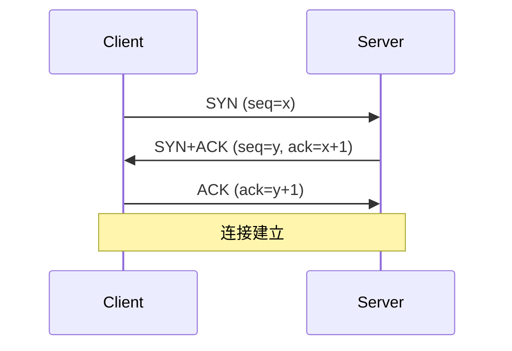
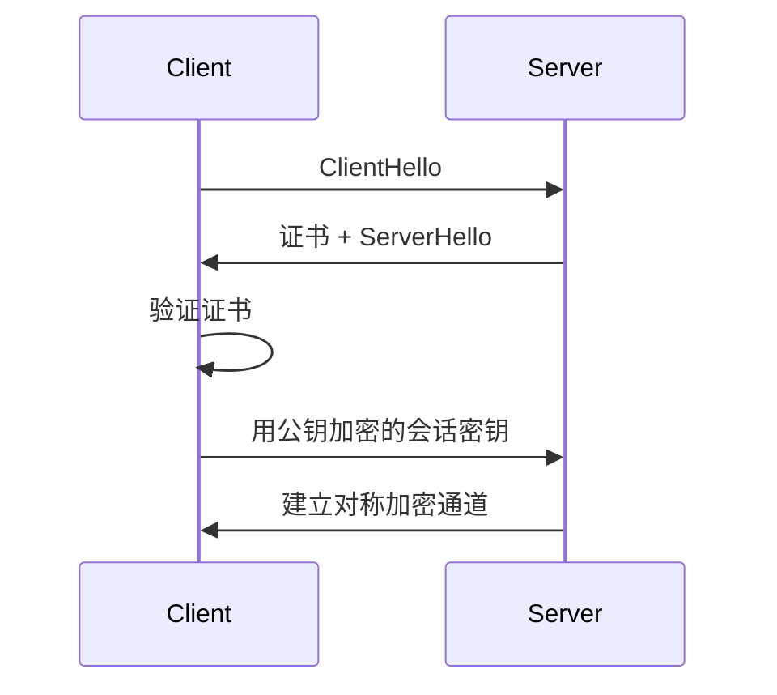

# 🌐 计算机网络与操作系统八股

> TCP/IP、HTTP、IO 模型、进程线程。后端必考。

---

## 目录

- [Part 1 网络分层与 TCP](#part-1-网络分层与-tcp)
- [Part 2 HTTP / HTTPS](#part-2-http--https)
- [Part 3 IO 模型](#part-3-io-模型)
- [Part 4 操作系统](#part-4-操作系统)

---

## Part 1 网络分层与 TCP

### Q1.1 网络分层？
**参考答案：** OSI 七层 / TCP/IP 四层（应用、传输、网络、网络接口）。常用记忆：物理-数据链路-网络-传输-会话-表示-应用。

### Q1.2 TCP 三次握手？
**参考答案：**

**为什么三次？** 双方都要确认**发送与接收能力**都正常，防止已失效的连接请求突然到达导致资源浪费。

### Q1.3 TCP 四次挥手？
**参考答案：** FIN → ACK → FIN → ACK。
**为什么四次？** 一方 FIN 后对方可能还有数据要发，需先 ACK 再等自己数据发完再 FIN（半关闭）。
**TIME_WAIT**：主动关闭方等待 2MSL，确保最后 ACK 到达、旧报文消散。

### Q1.4 TCP 如何保证可靠传输？
**参考答案：** ① 序号 + 确认（ACK）；② 超时重传；③ 快速重传；
④ 校验和；⑤ 流量控制（滑动窗口）；⑥ 拥塞控制。

### Q1.5 TCP 拥塞控制？
**参考答案：** 慢启动（指数增长）→ 拥塞避免（线性）→ 快重传 + 快恢复。核心：拥塞窗口 cwnd。

### Q1.6 TCP vs UDP？
**参考答案：**
| 维度 | TCP | UDP |
|---|---|---|
| 连接 | 面向连接 | 无连接 |
| 可靠 | 可靠、有序 | 不可靠、无序 |
| 速度 | 慢 | 快 |
| 场景 | 文件/网页 | 视频/游戏/DNS |

### Q1.7 TCP 粘包/拆包？
**参考答案：** TCP 是字节流无边界。解决：① 固定长度；② 分隔符；③ **长度字段**（最常用）。

---

## Part 2 HTTP / HTTPS

### Q2.1 常见 HTTP 状态码？
**参考答案：** 2xx 成功（200/201/204）、3xx 重定向（301/302/304）、
4xx 客户端错误（400/401/403/404/429）、5xx 服务端错误（500/502/503/504）。

### Q2.2 HTTP 方法？幂等性？
**参考答案：** GET（幂等，查询）、POST（非幂等，创建）、PUT（幂等，更新）、
DELETE（幂等）、PATCH（部分更新）、HEAD、OPTIONS。

### Q2.3 GET vs POST？
**参考答案：** GET 参数在 URL（可缓存、长度受限、幂等）；POST 参数在 body（不可缓存、无长度限、非幂等）。
语义上 GET 查询、POST 提交。

### Q2.4 HTTP/1.1 vs 2.0 vs 3.0？
**参考答案：**
- 1.1：长连接、管道化（队头阻塞）；
- 2.0：**二进制分帧、多路复用**、头部压缩（HPACK）、服务端推送；
- 3.0：基于 **QUIC（UDP）**，解决 TCP 队头阻塞。

### Q2.5 HTTPS 原理？
**参考答案：** HTTP + TLS。**非对称加密协商密钥 + 对称加密传输数据**。
流程：客户端请求 → 服务器返回证书 → 客户端验证证书（CA 链）→ 协商会话密钥 → 对称加密通信。

### Q2.6 对称 vs 非对称加密？
**参考答案：** 对称（AES）加解密快、密钥分发难；非对称（RSA/ECC）安全但慢。
HTTPS 用非对称协商密钥，对称传数据。

---

## Part 3 IO 模型

### Q3.1 五种 IO 模型？
**参考答案：**
| 模型 | 特点 |
|---|---|
| 阻塞 IO | 调用后一直等 |
| 非阻塞 IO | 轮询 |
| IO 多路复用 | select/poll/epoll |
| 信号驱动 IO | 信号通知 |
| 异步 IO（AIO） | 完成才通知 |

### Q3.2 select / poll / epoll？
**参考答案：**
| 维度 | select | poll | epoll |
|---|---|---|---|
| 句柄上限 | 1024 | 无 | 无 |
| 复杂度 | O(n) | O(n) | O(1)（就绪链表） |
| 内核拷贝 | 每次全量 | 每次全量 | mmap 共享 |
epoll 更适合**大量连接**（如 Redis、Nginx）。

### Q3.3 同步 vs 异步、阻塞 vs 非阻塞？
**参考答案：** 同步/异步关注**结果通知方式**；阻塞/非阻塞关注**调用是否立即返回**。
Java NIO 是**同步非阻塞**（多路复用），真正的异步是 AIO。

### Q3.4 Java 的 IO 模型？
**参考答案：** BIO（同步阻塞，一连接一线程）、NIO（多路复用，Selector 事件驱动）、AIO（异步回调）。

---

## Part 4 操作系统

### Q4.1 进程 vs 线程 vs 协程？
**参考答案：**
| 维度 | 进程 | 线程 | 协程 |
|---|---|---|---|
| 资源 | 独立地址空间 | 共享进程资源 | 用户态调度 |
| 切换开销 | 大 | 中 | 小 |
| 通信 | IPC | 共享内存 | 直接 |
**虚拟线程**（Java 21）即 JVM 级协程。

### Q4.2 进程通信方式？
**参考答案：** 管道、消息队列、共享内存（最快）、信号量、信号、Socket。

### Q4.3 进程调度算法？
**参考答案：** 先来先服务 FCFS、短作业优先 SJF、时间片轮转 RR、优先级、多级反馈队列。

### Q4.4 死锁的四个条件？
**参考答案：** ① 互斥；② 持有并等待；③ 不可剥夺；④ 循环等待。
**解决**：破坏任一条件——如资源有序分配（破坏循环等待）、一次性申请（破坏持有等待）。

### Q4.5 虚拟内存？
**参考答案：** 让每个进程认为自己独占内存，通过**页表**映射物理内存，支持**交换（swap）**。
好处：内存隔离、可运行大于物理内存的程序。

### Q4.6 缺页中断？
**参考答案：** 访问的页不在物理内存时触发，OS 从磁盘换入。页面置换算法：FIFO、**LRU**、LFU、Clock。

### Q4.7 用户态与内核态？
**参考答案：** 特权差异。系统调用、中断、异常触发切换（开销较大）。零拷贝（mmap/sendfile）可减少拷贝与切换。

---

<a href="README.md">← 返回备考中心</a>

