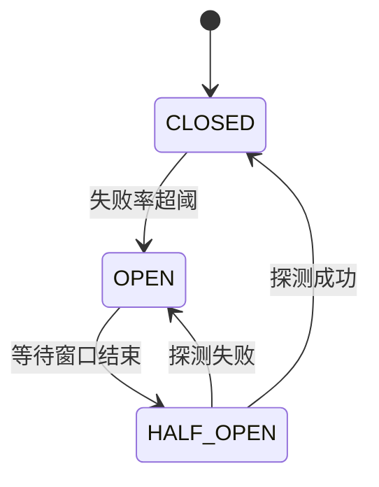

# 🕸 分布式与微服务八股

> CAP、一致性、分布式事务、限流熔断、消息队列。进阶必考。

---

## 目录

- [Part 1 理论基础](#part-1-理论基础)
- [Part 2 分布式事务](#part-2-分布式事务)
- [Part 3 服务治理](#part-3-服务治理)
- [Part 4 消息队列](#part-4-消息队列)
- [Part 5 分布式 ID 与锁](#part-5-分布式-id-与锁)
- [Part 6 微服务架构](#part-6-微服务架构)

---

## Part 1 理论基础

### Q1.1 CAP 理论？
**参考答案：** 分布式系统在**一致性 C、可用性 A、分区容错性 P** 三者中最多满足两个。
由于网络分区不可避免（P 必选），实际是在 **CP 与 AP 间取舍**：
- CP：ZooKeeper、etcd（牺牲可用性保一致）；
- AP：Eureka、Nacos（牺牲强一致保可用）。

### Q1.2 BASE 理论？
**参考答案：** 对 CAP 中 AP 的延伸：**基本可用、软状态、最终一致**。
是分布式事务/最终一致性方案的指导。

### Q1.3 一致性哈希？
**参考答案：** 把节点和数据都映射到哈希环，数据顺时针归属最近节点。
优势：**节点增减只影响相邻数据**，减少迁移。加**虚拟节点**解决数据倾斜。

---

## Part 2 分布式事务

### Q2.1 2PC 两阶段提交？
**参考答案：** 准备阶段（各参与者准备并锁定）→ 提交阶段（协调者决定提交/回滚）。
缺点：**同步阻塞、协调者单点、数据不一致风险**。

### Q2.2 TCC？
**参考答案：** Try（预留资源）→ Confirm（确认）→ Cancel（取消）。
业务侵入大，但灵活。适合强一致+高并发场景（如资金）。

### Q2.3 本地消息表 / 事务消息？
**参考答案：** 本地事务与消息发送解耦，保证**最终一致**：
本地业务表 + 消息表在同一本地事务写入 → 异步投递消息 → 消费方幂等处理。RocketMQ 事务消息是其变体。

### Q2.4 SAGA？
**参考答案：** 长事务拆成多个本地事务，每步有补偿操作。失败时反向补偿。最终一致，适合长流程。

### Q2.5 Seata 的 AT 模式？
**参考答案：** 两阶段 + **全局锁 + undo log**：一阶段提交本地事务并记录 undo/redo，
二阶段全局提交（异步清理）或回滚（用 undo log 反向补偿）。对业务**侵入小**。

### Q2.6 如何保证最终一致？
**参考答案：** ① 重试（幂等）；② 消息队列补偿；③ 定时对账；④ 版本号/状态机。

---

## Part 3 服务治理

### Q3.1 服务注册与发现？
**参考答案：** 服务启动注册到注册中心（Nacos/Eureka/Consul），消费方通过注册中心获取实例列表，
配合负载均衡调用。心跳维持存活，下线摘除。

### Q3.2 负载均衡算法？
**参考答案：** 轮询、加权轮询、随机、加权随机、最少连接、一致性哈希、响应时间加权。

### Q3.3 限流算法？
**参考答案：**
| 算法 | 特点 |
|---|---|
| 固定窗口 | 简单，有临界突刺 |
| 滑动窗口 | 平滑，精度高 |
| 漏桶 | 恒定速率流出，削峰 |
| 令牌桶 | 允许突发，最常用 |

> 💡 本项目 LLM 网关租户限流即固定窗口计数。

### Q3.4 熔断器三态？
**参考答案：**

- CLOSED：正常放行；
- OPEN：快速失败；
- HALF_OPEN：放少量探针试探恢复。
> 💡 本项目用 Resilience4j 实现**每端点独立熔断器**。

### Q3.5 降级策略？
**参考答案：** 返回兜底值、返回缓存、返回默认页面、异步补偿。保障核心功能可用。

### Q3.6 服务雪崩？怎么防？
**参考答案：** 上游调用链一个服务慢导致线程耗尽、级联失败。防御：**熔断 + 限流 + 降级 + 隔离（线程池/信号量舱壁）**。

---

## Part 4 消息队列

### Q4.1 MQ 的作用？
**参考答案：** **解耦、异步、削峰**。缺点：系统复杂度上升、一致性问题、消息重复/顺序。

### Q4.2 如何保证消息不丢？
**参考答案：** 三环节：
① 生产者确认（ACK/事务）；
② Broker 持久化（刷盘 + 副本）；
③ 消费者手动 ACK。

### Q4.3 消息重复怎么办？
**参考答案：** MQ 一般保证**至少一次**，需消费端**幂等**：
唯一 ID + 去重表、版本号、状态机、Redis 去重。

### Q4.4 如何保证消息顺序？
**参考答案：** 全局顺序难（牺牲吞吐）；通常**分区内有序**：
同一业务 key 发同一分区，单线程消费该分区。

### Q4.5 Kafka 高吞吐原理？
**参考答案：** ① **顺序写磁盘**；② **零拷贝**（sendfile）；③ 批量 + 压缩；
④ 分区并行；⑤ PageCache。

---

## Part 5 分布式 ID 与锁

### Q5.1 分布式 ID 方案对比？
**参考答案：**
| 方案 | 优点 | 缺点 |
|---|---|---|
| UUID | 简单 | 无序、占空间 |
| 数据库自增 | 有序 | 单点、性能瓶颈 |
| 雪花算法 | 趋势递增、高性能 | 依赖时钟 |
| 号段模式 | 批量取、性能好 | 有浪费 |

### Q5.2 分布式锁方案？
**参考答案：** Redis（AP，性能高）、ZooKeeper（CP，强一致）、etcd。
详见 [Redis 八股 Part 4](08-Redis八股.md)。

---

## Part 6 微服务架构

### Q6.1 微服务 vs 单体？
**参考答案：** 微服务独立部署、技术异构、按需扩容，但**运维复杂、分布式问题多**。
单体简单，适合早期。演进：单体 → 模块化 → 微服务。

### Q6.2 网关的作用？
**参考答案：** 统一入口：路由、鉴权、限流、熔断、日志、协议转换。
> 💡 本项目本质是**AI Agent 领域的网关/控制面**，与其思想一致。

### Q6.3 链路追踪？
**参考答案：** 通过 **TraceId + SpanId** 串联跨服务调用，工具：Sleuth/Zipkin、SkyWalking、Jaeger、OTel。

### Q6.4 配置中心？
**参考答案：** 集中管理配置、动态刷新、环境隔离、灰度。Nacos、Apollo、Spring Cloud Config。

### Q6.5 如何做灰度发布/蓝绿部署？
**参考答案：** 灰度：按比例/用户维度放量新版本；蓝绿：两套环境切换；配合监控快速回滚。

### Q6.6 服务网格（Service Mesh）？
**参考答案：** 把服务治理能力（流量、安全、观测）下沉到 **Sidecar 代理**（如 Istio + Envoy），
业务无侵入。与 Spring Cloud 应用层治理互补。

---

<a href="README.md">← 返回备考中心</a>

