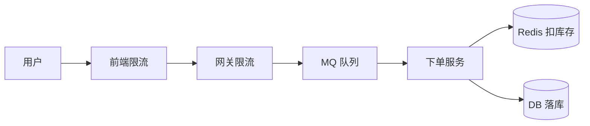
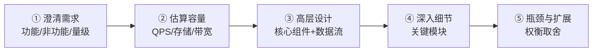
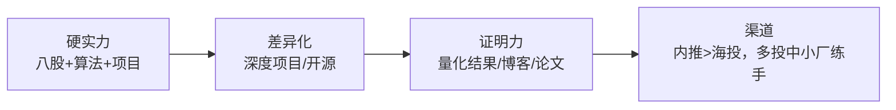

# 🧠 场景设计题与软技能

> 系统设计 + 项目讲述 + HR 面 + 反问。决定面试上限的部分。

---

## 目录

- [Part 1 系统设计题](#part-1-系统设计题)
- [Part 2 系统设计方法论](#part-2-系统设计方法论)
- [Part 3 项目讲述（STAR）](#part-3-项目讲述star)
- [Part 4 软技能与 HR 面](#part-4-软技能与-hr-面)
- [Part 5 反问环节](#part-5-反问环节)
- [Part 6 双非冲大厂策略](#part-6-双非冲大厂策略)

---

## Part 1 系统设计题

### Q1.1 设计一个短链接系统（如 t.cn）。
**参考答案框架：**
1. **需求**：长链→短链、短链→长链跳转、高并发读、低延迟、可统计。
2. **核心**：短码生成
   - 发号器（雪花/自增）→ **Base62** 编码；
   - 或哈希（MurmurHash）+ 冲突处理。
3. **存储**：KV（Redis 热点 + MySQL 持久）。
4. **读优化**：CDN / 多级缓存 / 布隆过滤器。
5. **扩展**：分库分表、读写分离、限流防刷。

### Q1.2 设计一个秒杀系统。
**参考答案框架：**
1. **核心矛盾**：瞬时高并发 + 超卖 + 库存一致性。
2. **分层削峰**：前端限流（按钮置灰）→ 网关限流 → 队列异步下单。
3. **库存**：Redis 预扣（Lua 原子）+ 异步落库；**库存预热**。
4. **防超卖**：Redis 原子操作 + DB 乐观锁（`WHERE stock>0`）。
5. **防刷**：验证码、IP/用户限流、风控。
6. **兜底**：熔断降级、限流返回友好提示。

### Q1.3 设计一个分布式 ID 生成器。
雪花算法（时间戳+机器ID+序列），或号段模式（DB 批量取号 + 内存分配），权衡时钟回拨。

### Q1.4 设计一个 IM 消息系统。
长连接（WebSocket/Netty）→ 消息路由 → 离线消息存储 → 已读回执 → 多端同步。难点：消息可靠、顺序、在线状态。

### Q1.5 设计一个 AI Agent 网关（结合本项目！）。
**参考答案框架：**
1. **接入**：统一 API（鉴权/租户）；
2. **护栏**：入口安全检测（决策模型）；
3. **路由**：按难度选模型档位（降本）；
4. **网关控制面**：模型路由、熔断、限流、成本、Key 池；
5. **工具治理**：MCP 网关 + 租户权限；
6. **记忆**：分层记忆 + 压缩；
7. **可观测**：指标 + 决策轨迹；
8. **评测**：自动化门禁。
> 👉 直接讲本项目的架构即可，是绝佳素材。

---

## Part 2 系统设计方法论

### Q2.1 系统设计题的答题框架？
**参考答案：**

**要点**：
- **先问清楚**再设计（别急着画图）；
- 主动**估算**（QPS、存储量）；
- 画**架构图**；
- 说**权衡**而非唯一答案；
- 关注**瓶颈**（单点、热点、一致性）。

### Q2.2 如何估算容量？
**参考答案：** 日活 × 人均请求 → 平均 QPS → **峰值 QPS ≈ 平均 × 3~10**；
存储 = 单条大小 × 日增量 × 保留天数；带宽 = QPS × 单次传输大小。

---

## Part 3 项目讲述（STAR）

### Q3.1 怎么讲项目让面试官眼前一亮？
**参考答案（STAR）：**
- **S 情境**：企业接入 AI Agent 的痛点（成本/治理/隔离/可观测）；
- **T 任务**：设计一个统一 Agent 运行时；
- **A 行动**：9 模块架构、Jev 决策下沉、网关控制面、多租户、熔断、评测；
- **R 结果**：**量化**——降本 X%、latency 下降、99%+ 成功率、踩了 3 个真实 Bug 并修复。

**加分**：讲**取舍**（WebFlux→RestClient、单 vs 多 Agent）、讲**踩坑**、讲**可复述的工程故事**。

### Q3.2 项目里最难的点是什么？
**参考答案（本项目）：**
「决策层组件装配、自动配置未加载、护栏误判这三个 Bug 层层递进，
尤其护栏 Bug 让我意识到**语义边界的划分比算法本身更重要**——
把『指令元数据』和『被判定数据』混在一起扫描，导致所有请求被误判。」

### Q3.3 如果重做会怎么改进？
**参考答案：** ① 更早引入端到端测试防止回归；② 决策层用状态机统一管理；
③ 记忆层直接上 Redis + 向量库；④ 接入真实模型做性能实测。

---

## Part 4 软技能与 HR 面

### Q4.1 高频 HR 问题与答题思路？
**参考答案：**
| 问题 | 思路 |
|---|---|
| 自我介绍 | 1 分钟：背景+技术栈+项目亮点+意向 |
| 为什么离职/换方向 | 正向表达（成长/匹配），不抱怨 |
| 职业规划 | 短期深耕技术，长期技术+业务 |
| 你的缺点 | 说真实但可改进的，+改进措施 |
| 最大成就 | 用 STAR + 量化 |
| 为什么选我们 | 结合公司业务与技术栈，显诚意 |
| 反问 | 见 Part 5 |

### Q4.2 如何处理与同事/Leader 的分歧？
**参考答案：** 用**数据/事实**说话，先理解对方立场，寻求**共同目标**，
小范围验证（POC），尊重最终决策并执行。

### Q4.3 如何展现学习能力？
**参考答案：** 举**主动学习并落地**的例子（如自学 Java 21 虚拟线程并用在项目里），
强调**闭环**（学 → 用 → 产出）。

---

## Part 5 反问环节

### Q5.1 反问该问什么？
**参考答案（好问题）：**
- 团队的技术栈与业务方向？
- 这个岗位的核心挑战是什么？
- 团队的技术氛围/成长路径？
- 项目的技术演进规划？
- 对新人的期望与培养机制？

**避免**：一上来问薪资/加班（可放最后，视情况）、能百度到的信息。

### Q5.2 反问的目的？
**参考答案：** ① 判断岗位是否匹配；② 展现你的**技术视野与主动性**；③ 争取信息对称。

---

## Part 6 双非冲大厂策略

### Q6.1 双非如何提升竞争力？
**参考答案：**

- **项目深度 > 数量**：一个能讲 40 分钟的深度项目，胜过 5 个 CRUD；
- **量化成果**：把性能、降本、成功率数字化；
- **开源/博客**：GitHub 高质量项目 + 技术文章是很好的背书；
- **算法**：刷够 Hot100 + 高频题，笔试不能挂；
- **渠道**：优先**内推**，海投走概率；
- **心态**：先拿中厂 offer 兜底，再冲大厂。

### Q6.2 简历怎么写？
**参考答案：**
- 一页为主，**STAR + 量化**；
- 项目写**你做了什么 + 用什么技术 + 取得什么结果**；
- 突出**技术难点与解决方案**；
- 关键技能与 JD 对齐（Java/并发/JVM/Spring/MySQL/Redis/分布式）。

### Q6.3 面试挂了怎么办？
**参考答案：** 复盘（哪块答不上）→ 补短板 → 继续投。
面试是**概率游戏**，一次失败不代表能力不行，坚持迭代必中。

---

## 🎯 最后叮嘱

1. **八股是基础，项目是决胜**——能深挖项目的人少，这是双非逆袭的机会；
2. **讲取舍，不讲绝对**——展现思考深度；
3. **主动延伸**——答完顺带补充相关知识，掌控节奏；
4. **诚实**——不会的坦诚「这块我还需要学习」，比硬编强；
5. **保持手感**——面试前集中刷题+模拟，状态很重要。

> 祝你顺利拿下中大厂 offer！🎉

---

<a href="README.md">← 返回备考中心</a>

