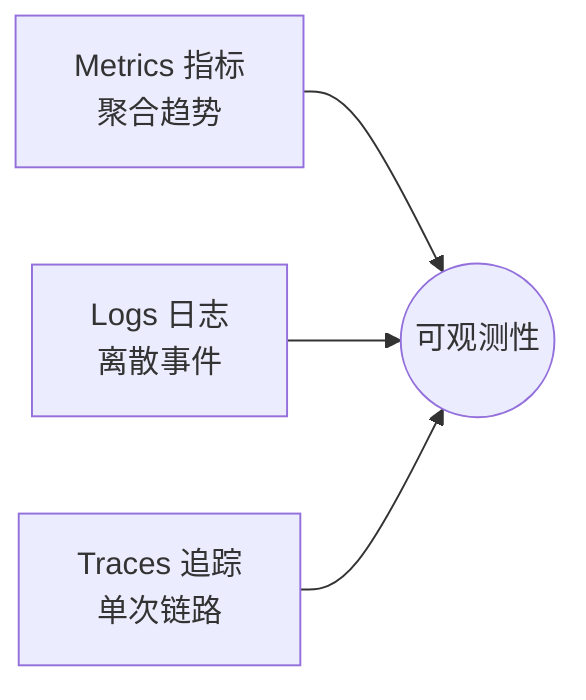

# 📊 项目可观测性与业务面试题

> 结合 JevAgentRuntime，覆盖**可观测性（Observability）**与**业务价值**两个面试方向。
> 这类题最能体现「你是不是只会写 CRUD」——能否讲清系统怎么被观测、业务怎么被量化。

---

## 目录

- [Part 1 可观测性总论](#part-1-可观测性总论)
- [Part 2 指标（Metrics）](#part-2-指标metrics)
- [Part 3 决策轨迹（Tracing）](#part-3-决策轨迹tracing)
- [Part 4 日志与告警](#part-4-日志与告警)
- [Part 5 评测与质量门禁](#part-5-评测与质量门禁)
- [Part 6 业务价值与量化](#part-6-业务价值与量化)
- [Part 7 开放与深挖](#part-7-开放与深挖)

---

## Part 1 可观测性总论

### Q1.1 什么是可观测性？三支柱是什么？
**参考答案：**
可观测性指**仅通过系统外部输出就能推断内部状态**的能力。
三大支柱：**指标（Metrics）、日志（Logs）、追踪（Traces）**。

**追问：AI Agent 的可观测和普通服务有何不同？**
还要观测**决策质量与成本**：token 消耗、每步决策、模型档位选择、任务成功率——
这也是本项目 `TraceRecorder` + `AgentMetrics` 要解决的核心问题。

### Q1.2 为什么 Agent 系统特别需要可观测？
**参考答案：**
Agent 是**多步自主**的，链路长、非确定性高：
① 出问题难复现（要看每步决策）；② 成本黑盒（不知花在哪）；
③ 质量难判（答得好不好）；④ 故障难定位（模型/工具/决策哪一环）。
所以必须把**每一步决策和行为**都记录下来。

### Q1.3 本项目可观测体系包含哪些部分？
**参考答案：**
| 部分 | 组件 | 作用 |
|---|---|---|
| 指标 | `AgentMetrics` + Micrometer | 暴露 Prometheus 指标 |
| 追踪 | `TraceRecorder` | 记录单次运行的决策轨迹 |
| 健康 | Spring Actuator | `/actuator/health` |
| 评测 | `jev-eval` + Jev-as-judge | 质量门禁回归 |

---

## Part 2 指标（Metrics）

### Q2.1 你在项目里埋了哪些指标？
**参考答案：**
- `llm_request_total{tenant,model,status}`：模型调用计数（含 `circuit_open`）；
- `jev_decision_*`：各类决策次数与延迟；
- `guardrail_block_total`：护栏拦截数；
- 运行级：步数、成本、评分。
**追问：为什么指标要带 tenant 标签？** 支持**多租户维度**的观测与成本归属。

### Q2.2 指标有哪些类型？
**参考答案：**
- **Counter**：只增（请求数、错误数）；
- **Gauge**：可增可减（当前队列长度、内存）；
- **Histogram**：分布（延迟分位 P50/P99）；
- **Summary**：客户端分位。
> 延迟用 **Histogram**（可算 P99），计数用 **Counter**。

### Q2.3 为什么用 Prometheus + Micrometer？
**参考答案：**
Micrometer 是**门面**（供应商中立），Spring Boot 原生集成；
Prometheus 是**拉取式**、生态成熟、PromQL 强大。换后端（如 Datadog）只改一行。

### Q2.4 如何用指标发现「供应商故障」？
**参考答案：**
监控 `rate(llm_request_total{status="circuit_open"}[5m])`。
熔断触发（本项目用 Resilience4j **每端点独立熔断**）会体现为 `circuit_open` 激增，
配合告警即可第一时间发现上游异常并切换备用端点。

### Q2.5 如何做多租户的成本观测？
**参考答案：**
`CostMeter` 按 `tenantId` 累计 token 成本，指标标签带 tenant，
既能看**全局成本**，也能看**单租户超支**，支撑预算熔断。

---

## Part 3 决策轨迹（Tracing）

### Q3.1 TraceRecorder 记了什么？为什么重要？
**参考答案：**
每次运行记录一个**有序步骤列表**，每步包含：
`kind`（guardrail/route/act/tool/verify/compact/grade）、
`jevPrimitive`、`jevValue`、摘要。
它是 Agent 的「黑匣子」——**出问题能回放每一步决策**，也是很好的调试与演示素材。

**追问：轨迹怎么用？**
① 调试；② 评测时分析失败原因；③ 前端展示决策过程；④ 审计。

### Q3.2 轨迹和分布式追踪（Trace）的区别？
**参考答案：**
- 分布式追踪（Zipkin/OTel）关注**跨服务调用的耗时链路**（Span）；
- 本项目的轨迹关注**单次 Agent 运行的决策序列**（做了什么判断）。
二者互补：生产上应把决策轨迹作为 **Span 的属性**挂到 OTel 链路上。

### Q3.3 如何把轨迹接入 OpenTelemetry？
**参考答案：**
每次运行开一个 Span，每个决策步骤开子 Span，
把 `jevPrimitive`/`jevValue` 作为 **Span attributes**；
用 `TraceRecorder` 的输出作为 span 事件。工具：OTel SDK + Jaeger/Tempo。

### Q3.4 怎么保证轨迹不拖垮性能？
**参考答案：**
① 异步/采样记录；② 只记关键字段（不记全量上下文）；
③ 轨迹落盘可异步批量；④ 高频路径可只在异常时全量记录。

---

## Part 4 日志与告警

### Q4.1 日志怎么分级和使用？
**参考答案：**
ERROR（异常）、WARN（可疑/降级）、INFO（关键事件）、DEBUG（调试）。
关键决策点 INFO 记录结构化信息（tenant/step/decision），便于检索聚合。

### Q4.2 你会设置哪些告警规则？
**参考答案：**
| 告警 | 条件 | 含义 |
|---|---|---|
| 高熔断率 | `rate(llm_request_total{status="circuit_open"}[5m]) > 0` | 供应商异常 |
| 高护栏拦截 | `guardrail_block_total` 突增 | 疑似攻击/误判 |
| 高决策延迟 | `histogram_quantile(0.99, jev_decision_latency)` 超阈 | Jev 变慢 |
| 预算濒临 | 租户累计成本接近预算 | 成本风险 |
| 成功率下降 | 任务成功率跌破阈值 | 质量问题 |

### Q4.3 告警太多怎么办？
**参考答案：**
① 分级（P0/P1/P2）；② 抑制与聚合（同源告警合并）；
③ 设置合理阈值与持续时间（for）；④ 定期治理「噪音告警」。

### Q4.4 如何做根因定位？
**参考答案：**
指标发现「哪里异常」→ 轨迹/日志定位「哪一步」→ 决策值显示「哪个判断出错」。
例如拦截激增 → 看护栏轨迹 → 发现风险词误判 → 定位到 `LocalJevClient` 逻辑。

---

## Part 5 评测与质量门禁

### Q5.1 什么是评测门禁？为什么需要？
**参考答案：**
用**黄金数据集**在每次发布前自动评测，通过率不达标就不允许上线。
作用：防止「改一处坏一片」的**质量回归**。本项目 `/api/eval/run` 即门禁入口，
用 **Jev-as-judge** 打分。

### Q5.2 什么是 Jev-as-judge？
**参考答案：**
用决策模型（或 LLM）充当**裁判**给输出打分，替代昂贵的人工评测。
本项目用 Jev 的 SCORE 原语打分，快且便宜，适合高频回归。

**追问：LLM-as-judge 的偏差？**
位置偏差、长度偏差、自我偏好——用交换顺序、评分标准、人工抽检缓解。

### Q5.3 评测集怎么设计？
**参考答案：**
覆盖**正例 + 反例**：正常任务（应 COMPLETED）、注入任务（应 BLOCKED）、
边界任务（多步、模糊）。指标：通过率、平均分、失败分类。

### Q5.4 如何量化「决策层」的效果？
**参考答案：**
A/B 对比「有 Jev 决策层 vs 无」：比较**任务成功率、平均步数、token 成本、延迟**。
本项目优化后步数从 6 降到 3，即决策/收敛改进的可量化证据。

---

## Part 6 业务价值与量化

### Q6.1 这个项目的业务价值是什么？
**参考答案（分层）：**
- **降本**：决策下沉 + 难度路由 + 上下文压缩 → token 成本显著下降；
- **提效**：Jev 快判断 → 每步延迟降低、收敛更快；
- **可控**：护栏 + 工具权限 + 多租户隔离 → 安全合规；
- **可运营**：指标 + 成本归属 → 能像运营普通服务一样运营 AI；
- **可持续**：评测门禁 → 质量可回归。

### Q6.2 你会用哪些量化指标向老板汇报？
**参考答案：**
| 维度 | 指标 |
|---|---|
| 成本 | 单次任务平均成本、降本 %、节省 token 数 |
| 性能 | P99 延迟、平均步数、QPS |
| 质量 | 任务成功率、评测通过率、拦截准确率 |
| 稳定性 | 熔断次数、错误率、可用性 |
| 业务 | 接入业务线数、调用量、租户数 |

### Q6.3 如果成本还是太高，你会怎么继续优化？
**参考答案：**
① 更细的难度路由（更多档位）；② 更激进的上下文压缩；
③ **语义缓存**复用相同/相似问题的结果；④ 小模型优先、大模型兜底；
⑤ 工具结果精简；⑥ 决策结果本地缓存。

### Q6.4 如何衡量「护栏」的业务价值（少了误伤、不少拦截）？
**参考答案：**
用**混淆矩阵**：真的恶意请求被拦截=TP，正常请求被误拦=FP，漏放=FN。
看**误报率（FP）**和**漏报率（FN）**，两者此消彼长，按业务定阈值。
本项目修 Bug#3 就是消除 FP 的过程。

### Q6.5 业务方反馈「Agent 答得不对」，你怎么排查？
**参考答案：**
① 看轨迹确认哪一步出错（路由错/工具错/校验错/生成错）；
② 看是否被护栏误拦；
③ 检查模型档位是否过低；
④ 抽评测集验证是否系统性退化；
⑤ 修复后加入评测集防止回归。

---

## Part 7 开放与深挖

### Q7.1 可观测性做得好不好，怎么评价？
**参考答案：**
能否**快速回答**这些问题：现在花多少钱？哪个租户异常？哪个模型劣化？
一次失败请求卡在哪一步？这次发布质量是否退化？
答得越快越准，可观测性越好。

### Q7.2 如何在不影响性能的前提下做好可观测？
**参考答案：**
采样、异步、聚合（指标代替海量日志）、只记关键字段、按需开启详细追踪。

### Q7.3 可观测性与成本、安全的平衡？
**参考答案：**
可观测本身有成本（存储/性能），需采样与分级；
安全上要注意**日志脱敏**（用户输入可能含敏感信息），避免观测成为泄露点。

### Q7.4 给这个项目加一个「可观测大屏」，你会展示什么？
**参考答案：**
实时 QPS/延迟、成本烧钱曲线（按租户）、模型分布、护栏拦截趋势、
熔断状态、评测通过率、失败 Top 原因。

### Q7.5 一句话总结「可观测性」对 AI 项目的意义？
**参考答案：**
「AI 项目最大的风险是**黑盒**——可观测性就是把 Agent 从『玄学』变成**可运营、可量化、可回归**的工程系统。」

---

<a href="README.md">← 返回备考中心</a>

