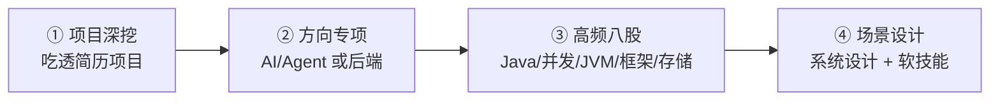
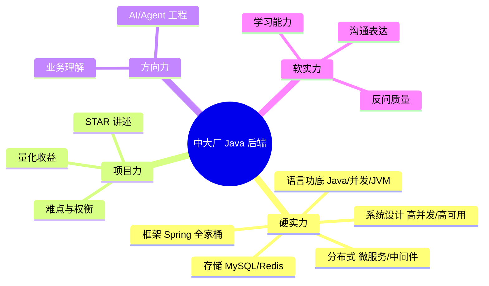

# 🎯 面试备考中心（resume）

> 面向**中大厂 / 大厂** Java 后端面试的系统化备考资料。
> 覆盖「项目深挖 → 方向专项 → 高频八股 → 场景设计」四层，题题带答案与追问。

> 🧭 使用建议：先刷「项目深挖」把简历项目吃透，再按目标岗位补「八股」，最后用「场景设计」串联。

---

## 📚 文档导航

| # | 文档 | 内容 | 优先级 |
|---|---|---|---|
| 01 | [项目深挖面试题（JevAgentRuntime）](01-项目深挖面试题-JevAgentRuntime.md) | 本项目全链路追问 + 答案 + 面试官视角 | ⭐⭐⭐⭐⭐ |
| 02 | [AI / Agent 方向面试题](02-AI-Agent方向面试题.md) | LLM/Agent/RAG/MCP/大模型工程 | ⭐⭐⭐⭐ |
| 03 | [Java 基础八股](03-Java基础八股.md) | 集合、泛型、异常、String、新特性 | ⭐⭐⭐⭐⭐ |
| 04 | [并发编程八股](04-并发编程八股.md) | JMM、synchronized、AQS、线程池、CAS | ⭐⭐⭐⭐⭐ |
| 05 | [JVM 八股](05-JVM八股.md) | 内存结构、GC、类加载、调优、JIT | ⭐⭐⭐⭐⭐ |
| 06 | [Spring / Spring Boot 八股](06-Spring与SpringBoot八股.md) | IoC、AOP、事务、自动配置、循环依赖 | ⭐⭐⭐⭐⭐ |
| 07 | [MySQL 八股](07-MySQL八股.md) | 索引、事务、锁、MVCC、SQL 优化 | ⭐⭐⭐⭐⭐ |
| 08 | [Redis 八股](08-Redis八股.md) | 数据结构、持久化、缓存问题、分布式锁 | ⭐⭐⭐⭐⭐ |
| 09 | [计算机网络与操作系统八股](09-计算机网络与操作系统八股.md) | TCP/IP、HTTP、IO 模型、进程线程 | ⭐⭐⭐⭐ |
| 10 | [分布式与微服务八股](10-分布式与微服务八股.md) | CAP、一致性、分布式事务、限流熔断 | ⭐⭐⭐⭐ |
| 11 | [场景设计题与软技能](11-场景设计题与软技能.md) | 系统设计、项目难点、HR 面、反问 | ⭐⭐⭐ |

---

## 🗺 备考路线

## 🧱 面试能力模型

---

## 💡 面试答题黄金法则

| 法则 | 说明 |
|---|---|
| **结论先行** | 先给一句话结论，再展开细节 |
| **分层展开** | 总 → 分 → 例，避免一上来堆细节 |
| **STAR 讲项目** | 情境-任务-行动-结果，结果务必量化 |
| **权衡意识** | 说清方案 A vs B 的取舍，而非只背答案 |
| **主动延伸** | 答完顺带提「相关的还有…」，展示知识面 |
| **不会就诚实** | 「这块我了解 X，Y 还需要学习」比硬编强 |

---

## 🔥 高频考点速览（Top 20）

| # | 考点 | 所属 |
|---|---|---|
| 1 | HashMap 原理 / 扩容 / 红黑树 | Java |
| 2 | ConcurrentHashMap 线程安全 | 并发 |
| 3 | synchronized 锁升级 | 并发 |
| 4 | AQS 与 ReentrantLock | 并发 |
| 5 | 线程池七参数与拒绝策略 | 并发 |
| 6 | JMM / volatile | 并发 |
| 7 | 内存结构与对象创建 | JVM |
| 8 | GC 算法与收集器 | JVM |
| 9 | 类加载与双亲委派 | JVM |
| 10 | Bean 生命周期 | Spring |
| 11 | 循环依赖三级缓存 | Spring |
| 12 | 事务传播与失效场景 | Spring |
| 13 | 自动配置原理 | Spring |
| 14 | B+ 树索引与最左前缀 | MySQL |
| 15 | MVCC 与隔离级别 | MySQL |
| 16 | 行锁/间隙锁/死锁 | MySQL |
| 17 | 缓存穿透/击穿/雪崩 | Redis |
| 18 | 分布式锁与 Redlock | Redis |
| 19 | TCP 三次握手/四次挥手 | 网络 |
| 20 | CAP 与分布式事务 | 分布式 |

---

<a href="../../README.md">← 返回项目 README</a>

